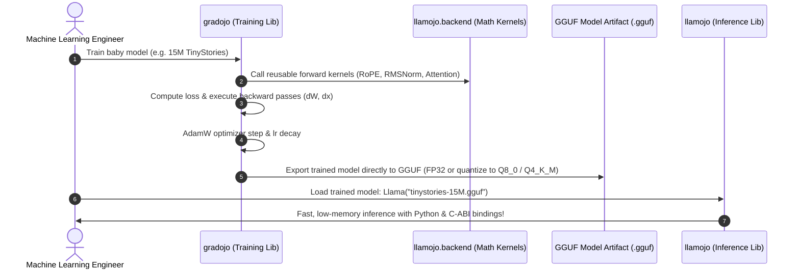

# Dual-Library Architecture: `llamojo` (Inference) & `gradojo` (Training)

## 1. Architectural Philosophy: Why Decouple?

Splitting inference and training into two separate, complementary libraries is an established, industry-proven design pattern (analogous to how ONNX Runtime / TensorRT / llama.cpp separate from PyTorch / JAX).

```
+---------------------------------------------------------------------------+
|                           DUAL-LIBRARY ECOSYSTEM                          |
+---------------------------------------------------------------------------+
|                                                                           |
| 1. llamojo (Inference Engine)             2. gradojo (Training Engine)  |
|  - Zero backward code / overhead           - Depends on llamojo's math    |
|  - Ultra-compact compiled binary (<3 MB)   - Heavy state: AdamW (m, v)    |
|  - Reuses single activation scratchpad     - Full activation tapes / dW   |
|  - Quantized kernels (Q4_K_M, Q8_0, etc.)  - Full FP32 / BF16 operations  |
|  - Direct Hugging Face GGUF consumer       - Outputs GGUF for llamojo     |
|                                                                           |
+---------------------------------------------------------------------------+
```

### The Conflict of Requirements
| Dimension | Inference Engine (`llamojo`) | Training Engine (`gradojo`) |
|---|---|---|
| **Memory Policy** | **Aggressive In-Place Overwrites**: 1 scratchpad vector $x$ reused across all $N$ layers. | **Activation Preservation**: Every intermediate layer output must be kept on a tape for backpropagation. |
| **Precision** | **Quantized & Asymmetric**: 4-bit (`Q4_K_M`) / 8-bit (`Q8_0`) integer SIMD instructions. | **Continuous & High-Precision**: High dynamic range FP32 or BF16 to prevent gradient underflow/stagnation. |
| **Batch Topology** | Vector-Matrix GEMV ($1 \times D \times D$) or tiny prompt bursts. | Dense Matrix-Matrix GEMM ($B \cdot T \times D \times D$) optimized for compute intensity. |
| **Binary Footprint** | Extremely lean (`libllamojo.so` ~3MB, zero external dependencies). | Extended tooling: dataloaders, checkpoint serializers, gradient clippers, optimizers. |

---

## 2. Reusing Inference for Forward Calculations: How It Works

Can the training library directly call the inference forward kernels? **Yes, with a structured "Tape/Collector" design.**

### The "Tape" Extension Pattern
In pure inference:
```mojo
# In llamojo (Inference): Fast, overwrites x in-place, zero allocations
def forward_layer(inout x: BufferPtr[Float32], w: TransformerWeights):
    rmsnorm(scratch, x, w.rms_att)
    attention(attn_out, scratch, ...)
    add(x, attn_out) # in-place residual
    rmsnorm(scratch, x, w.rms_ffn)
    swiglu(ffn_out, scratch, ...)
    add(x, ffn_out)  # in-place residual
```

In training:
Rather than rewriting the forward mathematical primitives (like `rmsnorm`, `swiglu`, `rope`, and attention projection), `gradojo` imports `llamojo.backend.*` and provides an **Activation Tape**:

```mojo
from llamojo.backend.kernels_norm_rope import rmsnorm, rope
from llamojo.backend.kernels_attn import attention
from llamojo.backend.micro_arch import swiglu

struct ForwardTape:
    var residual_1: List[Float32]
    var norm_1: List[Float32]
    var qk_scores: List[Float32]
    var attn_out: List[Float32]
    var residual_2: List[Float32]
    var ffn_gate: List[Float32]
    var ffn_up: List[Float32]

# In gradojo: Reuses llamojo primitives, but stashes intermediate buffers
def forward_layer_training(x: Matrix, w: TransformerWeights, inout tape: ForwardTape):
    tape.residual_1 = x.clone()
    rmsnorm(tape.norm_1.data, x.data, w.rms_att)      # llamojo primitive!
    attention(tape.attn_out.data, tape.norm_1.data)   # llamojo primitive!
    ...
```

---

## 3. Structural Synergy: The Cyclic Workflow

The two libraries complement each other without polluting either codebase:



---

## 4. Key Advantages of This Split

1. **Inference Stays Pure and Lightweight**:
   - `llamojo` stays clean, focused, and small. It has zero dead weight from AdamW state buffers, backward tape allocators, loss functions, or dataloaders.
   - Devices running inference (e.g., small servers, edge devices, laptops) only install `llamojo`.

2. **Zero Code Duplication for Fundamental Math**:
   - Both libraries share `llamojo/backend/isa.mojo` (AVX2/AVX-512 hardware SIMD detection) and `llamojo/backend/kernels_*.mojo`.
   - Any hardware speedup added to `llamojo`'s forward kernels (e.g., tiled matrix multiplication, improved SIMD intrinsics) immediately accelerates the forward pass in `gradojo`.

3. **Isolated Memory Profiles**:
   - `llamojo` operates inside a tight static memory ceiling (e.g., ~15 MB scratchpad + model size).
   - `gradojo` dynamically manages large activation pools and gradient arenas without risking memory fragmentation or regressions in the inference binary.

4. **Independent Release Cycles**:
   - The inference engine can release updates for Hugging Face compatibility, GBNF grammar samplers, or Python C-ABI bindings without touching the training pipelines.
   - The training engine can iterate on learning rate schedulers, gradient clipping, data streaming, and distributed data parallel (DDP) strategies independently.

---

## 5. Directory Blueprint for the Dual-Library Strategy

```
/mnt/c/Documents/Mojo/
├── llamojo/                     # Standalone Lightweight Inference Engine
│   ├── src/llamojo/
│   │   ├── backend/             # Reusable Math & SIMD Primitives (Shared)
│   │   │   ├── kernels_norm_rope.mojo
│   │   │   ├── kernels_attn.mojo
│   │   │   ├── kernels_quant.mojo
│   │   │   └── isa.mojo
│   │   ├── gguf.mojo            # GGUF File Reader
│   │   ├── sampler.mojo         # Greedy, Temp, Top-P, GBNF
│   │   └── c_api.mojo           # C-ABI & Python bindings (libllamojo.so)
│   └── python/llamojo/          # Drop-in llama-cpp-python API
│
└── gradojo/                   # Complementary Training Engine
    ├── src/gradojo/
    │   ├── autograd/            # Backward Kernels (dMatmul, dRMSNorm, dAttention, dSwiGLU)
    │   ├── tape.mojo            # Activation Cache Arena
    │   ├── loss.mojo            # Fused Cross-Entropy + Softmax Backward
    │   ├── optim.mojo           # AdamW & L2 Gradient Norm Clipping
    │   ├── dataloader.mojo      # Binary Token Shards Memory Mapper
    │   └── export_gguf.mojo     # GGUF Serializer & Quantizer (Bridges to llamojo)
    └── examples/
        └── train_tinystories.mojo
```

