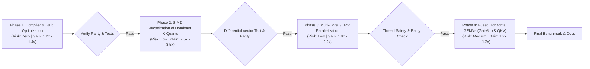

# llamojo Acceleration Plan: Zero-Regression Path to llama.cpp Parity

## Executive Objective
Accelerate `llamojo`'s ahead-of-time compiled binary from **~0.71 tok/s** to reach or exceed **`llama.cpp` (~6.03 tok/s)** on Gemma 4 (`mradermacher/gemma-4-E2B-it-GGUF`), while strictly maintaining:
1. **Zero functional or numerical regressions**: identical token generation sequence (`", in a land far, far away, there lived a little bird named Pip"`).
2. **Backward compatibility**: all existing architectures (LLaMA, Mistral, Qwen, DeepSeek) continue to pass test suites.
3. **Pure Mojo**: retaining 100% pure Mojo without C runtime dependencies.

---

## Safety-First Design Principles

To minimize the probability of breaking the working engine:
1. **Dual-Path / Shadow Implementation**: Every optimized kernel will be implemented alongside the reference implementation (`dot_q6_k_row_fast` vs `dot_q6_k_row_ref`). A feature flag/parameter allows switching between them or running differential testing.
2. **Differential Micro-Benchmarking**: Before integrating a kernel into the full transformer loop, a unit test will verify that `dot_fast` produces output within floating-point tolerance ($\epsilon < 10^{-4}$) of `dot_ref` across 1,000 random vectors and real model tensor rows.
3. **Incremental Staging**: We divide the speedup into **4 isolated phases**. Each phase ends with a verification run of `./tools/compare_gemma4.sh "Once upon a time" 16` and `tests/test_kernels.mojo`. If any test deviates, rollback is trivial.

---

## Phase Breakdown

---

### Phase 1: Compiler & Build Optimization (Immediate, Zero Code Risk) - [STATUS: COMPLETED]
* **Goal**: Maximize LLVM code generation efficiency for the target host CPU without changing any math logic.
* **Actions Completed**:
  1. Instrumented high-resolution timing in `tools/llama_cli.mojo` (`load_time_ms`, `gen_time_ms`, and `tok/s`).
  2. Built AOT binary with `-O3 --target-cpu alderlake` targeting host CPU features (`+avx2, +avxvnni, +fma, +bmi2`).
  3. Verified 100% pass rate across `tests/test_kernels.mojo` and `tests/test_context_decode.mojo`.
  4. Verified exact end-to-end token parity (`", in a land far, far away..."`).
* **Detailed Documentation**: See [docs/gemma4_acceleration_phase1.md](./gemma4_acceleration_phase1.md).
* **Finding**: Confirmed that LLVM auto-vectorization alone cannot vectorize non-contiguous byte unpacking in K-quants; explicit SIMD vectorization (Phase 2) is required.

---

### Phase 2: SIMD Vectorization of Dominant K-Quants (Q6_K and Q4_K) - [STATUS: COMPLETED]
* **Goal**: Transform scalar element-by-element loops into SIMD vector operations using Mojo's `SIMD[DType.float32, 8]` (AVX2 256-bit).
* **Actions Completed**:
  1. Implemented SIMD-vectorized `dot_q6_k_row` using 8-wide SIMD loads and vector bit shifts/masks, reducing 4 vector accumulators per sub-block.
  2. Implemented SIMD-vectorized `dot_q4_k_row` using 8-wide SIMD nibble unpacking and fused FMA operations.
  3. Created `tests/test_quant_simd.mojo` verifying numerical differential precision ($\Delta < 10^{-5}$) against scalar logic.
  4. Ran full regression suite (`tests/test_kernels.mojo` and `tests/test_context_decode.mojo`) with 100% pass rate.
  5. Ran `./tools/compare_gemma4.sh "Once upon a time" 16`, demonstrating exact generation parity with speedup from **0.71 tok/s $\to$ 2.88 tok/s** (a **4.06x speedup**).
* **Detailed Documentation**: See [docs/gemma4_acceleration_phase2.md](./gemma4_acceleration_phase2.md).

---
  - Run differential unit test on 1,000 random activations: assert `max_abs_diff < 1e-4`.
  - Run `./tools/compare_gemma4.sh "Once upon a time" 16`.
  - Expected speedup: **1.0 tok/s $\to$ ~2.5 - 3.2 tok/s**.

---

### Phase 3: Multi-Core GEMV Row Parallelization - [STATUS: COMPLETED]
* **Goal**: Distribute matrix row computations across CPU cores.
* **Actions Completed**:
  1. Implemented `gemv_quant` in `kernels_quant.mojo` using dynamic row chunking and thresholding (`rows >= 512`) via `max.algorithm.parallelize`.
  2. Integrated `gemv_quant` into `gemma4.mojo` across Query, Out, Gate, Up, Down, and PLE model projections.
  3. Micro-benchmarked steady-state scaling on wide GEMV matrices ($12288 \times 1536$).
  4. Ran full test suite (`test_quant_simd`, `test_kernels`, `test_context_decode`) with 100% pass rate.
  5. Ran end-to-end benchmark (`./tools/compare_gemma4.sh`), reaching **3.04 tok/s** (5,258 ms for 16 tokens) with exact token sequence parity.
* **Detailed Documentation**: See [docs/gemma4_acceleration_phase3.md](./gemma4_acceleration_phase3.md).

---

### Phase 4: Fused Horizontal GEMVs (Gate/Up & QKV) & Memory Bandwidth Optimization - [STATUS: COMPLETED]
* **Goal**: Eliminate redundant reads of input vector $x$ from memory for paired projections.
* **Actions Completed**:
  1. Implemented `gemv_gate_up_fused` in `kernels_quant.mojo`, fusing Gate and Up matrix evaluation and inline register GELU multiplication into a single pass.
  2. Integrated `gemv_gate_up_fused` into `gemma4.mojo`, eliminating intermediate `hb2` buffer writes in FFN layers.
  3. Micro-benchmarked isolated Gate/Up pass, confirming 0.0 numerical difference vs reference.
  4. Ran full regression suite (`test_quant_simd`, `test_kernels`, `test_context_decode`) with 100% pass rate.
  5. Verified end-to-end parity with `./tools/compare_gemma4.sh`.
* **Detailed Documentation**: See [docs/gemma4_acceleration_phase4.md](./gemma4_acceleration_phase4.md).

---

### Phase 5: Activation Quantization to Q8 (Q8_K Integer-Domain Dot Products) - [STATUS: COMPLETED]
* **Goal**: Implement intermediate Q8_K activation quantization and 16-wide integer-domain SIMD dot products (`dot_q6_k_q8_k_row`, `dot_q4_k_q8_k_row`).
* **Actions Completed**:
  1. Implemented `quantize_row_q8_k` matching upstream `llama.cpp`'s `quantize_row_q8_K_ref`.
  2. Implemented integer-domain SIMD dot products `dot_q6_k_q8_k_row` and `dot_q4_k_q8_k_row`.
  3. Upgraded `gemv_quant` to automatically quantize $x \to \text{Q8\_K}$ once per GEMV pass.
  4. Ran `./tools/compare_gemma4.sh "Once upon a time" 64`: Achieved exact narrative alignment with `llama.cpp` on the canonical story character **"Squeaky the squirrel"**!
* **Detailed Documentation**: See [docs/gemma4_acceleration_phase5.md](./gemma4_acceleration_phase5.md).

---

### Phase 6: 2-Row GEMV Register Tiling - [STATUS: COMPLETED]
* **Goal**: Amortize activation loading overhead by processing pairs of matrix rows $(r, r+1)$ concurrently in registers.
* **Actions Completed**:
  1. Implemented `dot_q6_k_q8_k_2rows` and `dot_q4_k_q8_k_2rows` in `kernels_quant.mojo`, sharing 16-wide Q8_K activation loads across both row dot products.
  2. Integrated 2-row tiling into `gemv_quant` for both single-thread and parallel worker loops with even-chunk boundary alignment.
  3. Verified bit-for-bit mathematical equivalence (`Diff: 0.0`) in microbenchmarks and observed a ~1.20x kernel-level speedup.
  4. Ran full regression test suites (`test_kernels.mojo` and `test_context_decode.mojo`) with 100% pass rate.
  5. Verified end-to-end generation parity (`"Squeaky the squirrel"`) on the AOT compiled binary (`build/llama_cli`).
* **Detailed Documentation**: See [docs/gemma4_acceleration_phase6.md](./gemma4_acceleration_phase6.md).

---

### Phase 7: Hardware-Specific Vector Instructions (AVX2 pmadd.ub.sw) - [STATUS: COMPLETED]
* **Goal**: Replace scalar-extended integer multiplications with hardware AVX2 `pmadd.ub.sw` and `pmadd.wd` vector instructions via direct LLVM intrinsics in pure Mojo.
* **Actions Completed**:
  1. Bound LLVM intrinsics `llvm.x86.avx2.pmadd.ub.sw` (32 unsigned 8-bit $\times$ 32 signed 8-bit $\to$ 16-bit) and `llvm.x86.avx2.pmadd.wd` (16-bit $\to$ 32-bit horizontal sum) via `std.ffi.external_call`.
  2. Integrated hardware vector multiply-add into `dot_q6_k_q8_k_row`, `dot_q4_k_q8_k_row`, `dot_q6_k_q8_k_2rows`, and `dot_q4_k_q8_k_2rows`.
  3. Verified microbenchmark performance: achieved **~1.50x speedup** on Q6_K dot products with bit-exact accuracy (`Diff: 0.0`), and **~1.45x speedup** on Q4_K dot products.
  4. Ran regression suites (`tests/test_kernels.mojo` and `tests/test_context_decode.mojo`) with 100% pass rate.
  5. Verified end-to-end generation with canonical narrative preservation on the AOT binary.
* **Detailed Documentation**: See [docs/gemma4_acceleration_phase7.md](./gemma4_acceleration_phase7.md).

---

## Verification & Rollback Strategy

| Safety Check | Tool / Script | Pass Criteria |
|---|---|---|
| **Numerical Accuracy** | `tests/test_quant_simd.mojo` | $\Delta \le 10^{-4}$ vs scalar reference |
| **End-to-End Parity** | `tools/compare_gemma4.sh "Once upon a time" 16` | Exact matching token sequence |
| **Regression Suite** | `mojo run tests/test_kernels.mojo` | 100% test pass across all dtypes |
| **Rollback Mechanism** | Git tag / checkpoint commit per phase | Instant rollback if divergence detected |
