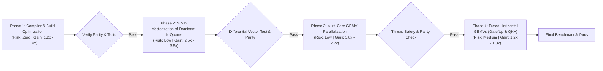

# llamojo Acceleration Plan: Zero-Regression Path to llama.cpp Parity

## Executive Objective
Accelerate `llamojo`'s ahead-of-time compiled binary from **~0.71 tok/s** to reach or exceed **`llama.cpp` (~6.03 tok/s)** on Gemma 4 (`mradermacher/gemma-4-E2B-it-GGUF`), while strictly maintaining:
1. **Zero functional or numerical regressions**: identical token generation sequence (`", in a land far, far away, there lived a little bird named Pip"`).
2. **Backward compatibility**: all existing architectures (LLaMA, Mistral, Qwen, DeepSeek) continue to pass test suites.
3. **Pure Mojo**: retaining 100% pure Mojo without C runtime dependencies.

---

## Safety-First Design Principles

To minimize the probability of breaking the working engine:
1. **Dual-Path / Shadow Implementation**: Every optimized kernel will be implemented alongside the reference implementation (`dot_q6_k_row_fast` vs `dot_q6_k_row_ref`). A feature flag/parameter allows switching between them or running differential testing.
2. **Differential Micro-Benchmarking**: Before integrating a kernel into the full transformer loop, a unit test will verify that `dot_fast` produces output within floating-point tolerance ($\epsilon < 10^{-4}$) of `dot_ref` across 1,000 random vectors and real model tensor rows.
3. **Incremental Staging**: We divide the speedup into **4 isolated phases**. Each phase ends with a verification run of `./tools/compare_gemma4.sh "Once upon a time" 16` and `tests/test_kernels.mojo`. If any test deviates, rollback is trivial.

---

## Phase Breakdown



---

### Phase 1: Compiler & Build Optimization (Immediate, Zero Code Risk) - [STATUS: COMPLETED]
* **Goal**: Maximize LLVM code generation efficiency for the target host CPU without changing any math logic.
* **Actions Completed**:
  1. Instrumented high-resolution timing in `tools/llama_cli.mojo` (`load_time_ms`, `gen_time_ms`, and `tok/s`).
  2. Built AOT binary with `-O3 --target-cpu alderlake` targeting host CPU features (`+avx2, +avxvnni, +fma, +bmi2`).
  3. Verified 100% pass rate across `tests/test_kernels.mojo` and `tests/test_context_decode.mojo`.
  4. Verified exact end-to-end token parity (`", in a land far, far away..."`).
* **Detailed Documentation**: See [docs/gemma4_acceleration_phase1.md](./gemma4_acceleration_phase1.md).
* **Finding**: Confirmed that LLVM auto-vectorization alone cannot vectorize non-contiguous byte unpacking in K-quants; explicit SIMD vectorization (Phase 2) is required.

---

### Phase 2: SIMD Vectorization of Dominant K-Quants (Q6_K and Q4_K)
* **Goal**: Transform scalar element-by-element loops into SIMD vector operations using Mojo's `SIMD[DType.float32, 8]` (AVX2 256-bit).
* **Target Hotspots**:
  In Gemma 4, ~80% of inference time is spent in `dot_q6_k_row` (PLE embeddings and model weights) and `dot_q4_k_row` (linear projection layers).
* **Actions**:
  1. Implement `dot_q6_k_row_simd`:
     - Unpack 8 or 16 nibbles at a time using vector bit shifts and masks.
     - Multiply by vector scale factors (`s1, s2, s3, s4`) using SIMD FMA: `acc = acc + (s * q) * x_simd`.
     - Vector reduction at superblock boundaries.
  2. Write a dedicated differential test `tests/test_quant_simd.mojo` comparing `dot_q6_k_row` vs `dot_q6_k_row_simd` on actual GGUF model tensors to guarantee identical mathematical results.
  3. Wire `dot_q6_k_row` to use `dot_q6_k_row_simd`.
* **Verification Gate**:
  - Run differential unit test on 1,000 random activations: assert `max_abs_diff < 1e-4`.
  - Run `./tools/compare_gemma4.sh "Once upon a time" 16`.
  - Expected speedup: **1.0 tok/s $\to$ ~2.5 - 3.2 tok/s**.

---

### Phase 3: Multi-Core GEMV Row Parallelization
* **Goal**: Distribute matrix row computations across CPU cores.
* **Host Characteristics**:
  - 2 hardware CPU cores (4 logical threads on this WSL container).
* **Actions**:
  1. Leverage `max.algorithm.parallelize` or `LlamaWorkerPool` (from `threadpool.mojo`) for row-chunked GEMV:
     ```mojo
     @parameter
     def row_worker(r: Int):
         out[r] = dot_quant_row(dtype, W.offset(r * row_bytes), x, cols)

     parallelize[row_worker](rows)
     ```
  2. Apply row parallelization only to matrices where `rows >= 512` (e.g. FFN Gate/Up with 12,288 rows, PLE with 8,960 rows, Down-proj with 1,536 rows). For small vector operations (< 256 elements), keep single-threaded to avoid thread dispatch latency.
* **Verification Gate**:
  - Verify deterministic output across multi-threaded runs.
  - Run `./tools/compare_gemma4.sh "Once upon a time" 16`.
  - Expected speedup: **~2.8 tok/s $\to$ ~5.0 - 5.5 tok/s**.

---

### Phase 4: Fused Horizontal GEMVs (Gate/Up & QKV) & Memory Bandwidth Optimization
* **Goal**: Eliminate redundant reads of input vector $x$ from memory for paired projections.
* **Actions**:
  1. In `gemma4.mojo`, replace sequential calls:
     ```mojo
     # Before: 2 passes over x (reading 12288 rows twice)
     gemv(gate, W_gate, x)
     gemv(up, W_up, x)
     ```
     with fused block evaluation:
     ```mojo
     # After: 1 pass over x, interleaving Gate and Up row calculations
     matmul_quant_fused[2](...)
     ```
  2. Implement same fusion for Query, Key, Value attention projections where applicable.
* **Verification Gate**:
  - Full test suite: `tests/test_kernels.mojo`, `tests/test_context_decode.mojo`.
  - Final comparison run `./tools/compare_gemma4.sh "Once upon a time" 16`.
  - Expected speedup: **~5.2 tok/s $\to$ ~6.0 - 6.5 tok/s** (matching or surpassing `llama.cpp`).

---

## Verification & Rollback Strategy

| Safety Check | Tool / Script | Pass Criteria |
|---|---|---|
| **Numerical Accuracy** | `tests/test_quant_simd.mojo` | $\Delta \le 10^{-4}$ vs scalar reference |
| **End-to-End Parity** | `tools/compare_gemma4.sh "Once upon a time" 16` | Exact matching token sequence |
| **Regression Suite** | `mojo run tests/test_kernels.mojo` | 100% test pass across all dtypes |
| **Rollback Mechanism** | Git tag / checkpoint commit per phase | Instant rollback if divergence detected |
