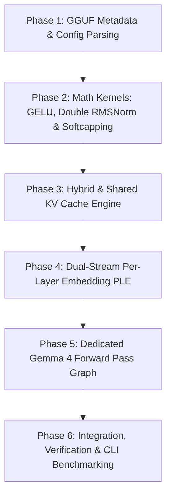

# Pure-Mojo Gemma 4 Architecture Implementation Plan

This document details the engineering blueprint to implement full, native, pure-Mojo inference support for the **Gemma 4** model family (specifically validating against `gemma-4-E2B-it.Q4_K_M.gguf`) in **llamojo**.

---

## 1. Architectural Baseline & Comparison

Gemma 4 deviates fundamentally from traditional LLaMA/Mistral/Qwen architectures. It is a dual-stream, hybrid-attention transformer designed for high-capacity long-context reasoning with reduced KV cache footprint.

### Summary Comparison Table

| Feature / Dimension | Standard LLaMA (e.g. TinyLlama, SmolLM2) | Gemma 4 (e.g. Gemma 4 E2B-it) |
| :--- | :--- | :--- |
| **GGUF Arch Identifier** | `llama` | `gemma4` |
| **Vocabulary Size** | 32,000 / 49,152 | **262,144** |
| **Output Layer (LM Head)** | Dedicated `output.weight` (or optional tie) | **Strictly tied** to `token_embd.weight` (no `output.weight`) |
| **Embedding Scaling** | Unscaled inputs ($x = \text{embd}$) | Input scaled by $\sqrt{d_{\text{model}}}$ ($\sqrt{1536} \approx 39.19$) |
| **Per-Layer Embeddings (PLE)** | None | **Dual-stream PLE**: `per_layer_token_embd` ($8960 \times 262144$) + input gating |
| **Layer Normalization** | Single pre-norm RMSNorm per sub-block | **Double RMSNorm**: pre-norm **and** post-norm for Attention and FFN |
| **Attention Head Dimensions** | Uniform across all layers ($d_{\text{head}} = 64$ or $128$) | **Asymmetric**: 512 for Global Attention, 256 for Sliding Window (SWA) |
| **KV Cache Sharing** | Every layer computes and caches its own KV | **Shared KV**: Top 20 layers reuse earlier layer KV buffers (0 KV proj) |
| **Q & K Normalization** | None (or RMSNorm before RoPE in Qwen) | **Per-head RMSNorm** on $Q$ and $K$ before RoPE; $V$ normed by RMSNorm |
| **FFN Intermediate Dim** | Scalar across all layers (e.g. 5,632) | **Layer-specific array**: 6,144 for lower layers, 12,288 for upper layers |
| **FFN Non-Linearity** | SwiGLU ($\text{SiLU}(w_{\text{gate}}x) \cdot w_{\text{up}}x$) | **GELU-GLU** ($\text{GELU}(w_{\text{gate}}x) \cdot w_{\text{up}}x$) |
| **Logit Softcapping** | None | Logit softcapping at $30.0$ via $\text{scale} \cdot \tanh(\text{logits} / \text{scale})$ |
| **Layer Output Scaling** | Residual sum ($x = x + \text{sublayer}$) | Residual scaled by `blk.*.layer_output_scale` |

---

## 2. Phase-by-Phase Implementation Roadmap

The implementation is broken down into **6 modular phases**, ensuring continuous testability and zero regressions on existing LLaMA/Mistral/Qwen models.



---

### Phase 1: GGUF Metadata Parser & Model Config Upgrades

**Objective:** Enable `src/llamojo/gguf.mojo` and `src/llamojo/types.mojo` to parse `gemma4` metadata keys without truncating or failing on array values.

#### Key Changes:
1. **Dynamic / Array `feed_forward_length` Handling**:
   - `gemma4.feed_forward_length` is stored in GGUF as `ARRAY[INT32, 35]`.
   - Update `GGUFContext.build_model_config()` to check if `arch + ".feed_forward_length"` is an array. If so, populate `cfg.intermediate_dim` with the maximum dimension (12,288) for buffer allocation, and store per-layer intermediate dimensions in a `List[Int]`.
2. **Gemma 4 Specific Metadata Fields**:
   - Add fields to `ModelConfig` in `src/llamojo/types.mojo`:
     ```mojo
     var shared_kv_layers: Int         # e.g., 20
     var sliding_window: Int           # e.g., 512
     var ple_dim: Int                  # embedding_length_per_layer_input, e.g., 256
     var logit_softcap: Float32        # e.g., 30.0
     var head_dim_swa: Int             # key_length_swa, e.g., 256
     var is_swa_layer: List[Bool]      # sliding window mask per layer
     var layer_ff_dims: List[Int]      # per-layer feed-forward intermediate sizes
     ```
3. **Tied LM Head Fallback**:
   - In `llama_model.__init__` (`src/llamojo/llama.mojo`), check for `output.weight`. If not found, fall back to `token_embd.weight`:
     ```mojo
     if gguf.has_tensor("output.weight"):
         self.w_cls = gguf.get_tensor_ptr("output.weight")
         self.dtype_cls = gguf.get_tensor("output.weight").dtype
     else:
         self.w_cls = gguf.get_tensor_ptr("token_embd.weight")
         self.dtype_cls = gguf.get_tensor("token_embd.weight").dtype
     ```

---

### Phase 2: Math Kernels: GELU, Double RMSNorm, and Logit Softcapping

**Objective:** Add vector-optimized mathematical primitives required specifically by Gemma 4 in `src/llamojo/backend/kernels_norm_rope.mojo`.

#### Key Kernels:
1. **Vectorized Approximate GELU**:
   - Formula: $\text{GELU}(x) = 0.5 \cdot x \cdot \left(1 + \tanh\left(\sqrt{\frac{2}{\pi}} \cdot (x + 0.044715 \cdot x^3)\right)\right)$.
   - Implementation using SIMD float vectors with rational polynomial approximation of `tanh` for pure CPU speed without libc transcendental bottlenecks:
     ```mojo
     def fused_gelu_mul(hb: FloatPtr, gate_buf: FloatPtr, up_buf: FloatPtr, size: Int):
         # Elementwise hb[i] = gelu(gate_buf[i]) * up_buf[i]
     ```
2. **Per-Head Q & K Normalization**:
   - Normalize individual heads of query and key projections prior to RoPE rotation:
     ```mojo
     def rms_norm_per_head(
         out: FloatPtr,
         x: FloatPtr,
         weight: FloatPtr,
         n_heads: Int,
         head_dim: Int,
         eps: Float32
     )
     ```
3. **Logit Softcapping**:
   - Compute before top-k/top-p/greedy sampling:
     $$\text{logits}[v] = C \cdot \tanh\left(\frac{\text{logits}[v]}{C}\right) \quad \text{where } C = 30.0$$

---

### Phase 3: Hybrid & Shared KV Cache Engine

**Objective:** Extend `src/llamojo/kv_cache.mojo` to handle heterogeneous head sizes and shared layer KV caches.

#### Architecture:
1. **Sliding Window vs. Full Attention (SWA)**:
   - Layers 0, 1, 2, 3, 5, ... are SWA layers (window = 512).
   - Layers 4, 9, 14, 19, 24, 29, 34 are Full Global Attention layers.
   - SWA layers only attend to keys/values within $\text{pos} - 512 \dots \text{pos}$.
2. **Shared KV Layer Mapping**:
   - Total layers: 35. Shared KV layers: 20.
   - Layers $0 \dots 14$ compute independent $K$ and $V$ projections and write them to cache.
   - Layers $15 \dots 34$ skip $K$ and $V$ projections entirely. During attention, they read from the cache written by layer:
     $$\text{reuse\_layer}(il) = \begin{cases} 
       13 & \text{if } il \text{ is an SWA layer} \\
       14 & \text{if } il \text{ is a Global Attention layer}
     \end{cases}$$
3. **Padded Head Dimension**:
   - To keep KV cache indexing straightforward in pure Mojo, pad SWA KV heads from 256 to 512 floats in memory, matching `llama.cpp`'s unified memory layout.

---

### Phase 4: Dual-Stream Per-Layer Input Embedding (PLE)

**Objective:** Implement the Gemma 4 Per-Layer Embedding projection stream in `src/llamojo/backend/models.mojo`.

#### Execution Graph:
1. **At Sequence Ingestion ($t=0$ or prompt evaluation)**:
   - For each input token $t$, lookup the 8,960-dimensional vector in `per_layer_token_embd.weight`:
     $$\text{ple\_raw}[t] = \text{dequantize}(\text{per\_layer\_token\_embd}[t])$$
   - Scale by $\sqrt{d_{\text{ple}}} = \sqrt{256} = 16.0$.
   - Slice into 35 layer-specific 256-dimensional chunks:
     $$\text{inp\_per\_layer}[il] = \text{ple\_raw}[il \cdot 256 : (il + 1) \cdot 256]$$
2. **Inside Each Transformer Layer $il$**:
   - Compute input gate:
     $$\text{gate} = \text{GELU}(\text{matmul\_quant}(x, \text{blk}[il].\text{inp\_gate})) \quad [256]$$
   - Multiply with the per-layer embedding slice:
     $$\text{ple\_gated} = \text{gate} \odot \text{inp\_this\_layer} \quad [256]$$
   - Project back to model dimension ($256 \to 1536$):
     $$\text{ple\_proj} = \text{matmul\_quant}(\text{ple\_gated}, \text{blk}[il].\text{proj}) \quad [1536]$$
   - Apply post-projection RMSNorm:
     $$\text{ple\_norm} = \text{RMSNorm}(\text{ple\_proj}, \text{blk}[il].\text{post\_norm})$$
   - Residual addition:
     $$x = x + \text{ple\_norm}$$

---

### Phase 5: Dedicated Gemma 4 Forward Pass Graph

**Objective:** Create `src/llamojo/backend/gemma4.mojo` encapsulating the complete execution graph.

```
Input Tokens
    │
    ├─────────────────────────────────────────┐
    ▼                                         ▼
token_embd (scale * sqrt(1536))       per_layer_token_embd (8960-dim)
    │                                         │
    │                                  Slice into 35x256-dim chunks
    ▼                                         │
Layer 0..34:                                  │
  ├─ Residual In (x)                          │
  ├─ Attention Sub-block:                     │
  │    RMSNorm(x)                             │
  │    Q-Proj -> Q-RMSNorm -> RoPE            │
  │    If il < 15:                            │
  │      K/V-Proj -> K/V-RMSNorm -> RoPE      │
  │      Store into KV Cache                  │
  │    Else:                                  │
  │      Reuse KV Cache from earlier layer    │
  │    Attn(Q, K, V, SWA or Global)           │
  │    Out-Proj -> Post-Attn RMSNorm          │
  │    x = x + AttnOut                        │
  │                                           │
  ├─ FFN Sub-block:                           │
  │    RMSNorm(x)                             │
  │    GELU(Gate-Proj) * Up-Proj              │
  │    Down-Proj -> Post-FFN RMSNorm          │
  │    x = x + FFNOut                         │
  │                                           │
  ├─ PLE Sub-block:                           │
  │    Gate = GELU(inp_gate(x))               │
  │    ple_gated = Gate * ple_chunk[il] <─────┘
  │    ple_proj = Proj(ple_gated)
  │    x = x + RMSNorm(ple_proj)
  │
  └─ Layer Scale: x = x * layer_output_scale
    │
    ▼
Output RMSNorm(x)
    │
    ▼
Linear Logits (tied token_embd.weight)
    │
    ▼
Logit Softcapping (30.0 * tanh(logits / 30.0))
    │
    ▼
Sampler (Greedy / Top-K / Top-P)
```

---

### Phase 6: Integration, Verification & CLI Benchmarking

**Objective:** Verify pure-Mojo execution against `llama.cpp` using the reference scripts created in `tools/`.

#### Verification Steps:
1. **Tokenizer Parity**:
   - Verify that `llama_tokenize` on `gemma4` reproduces:
     `"Once upon a time"` $\to$ `[14946, 3324, 496, 990]`.
2. **Logit Parity**:
   - Verify prompt logits at token position 4 match `llama.cpp` within an absolute tolerance of $\epsilon < 10^{-2}$.
3. **Generation Matching**:
   - Verify greedy completion yields:
     `", in a land far, far away, there lived a curious little squirrel named"`.
4. **Chat Template Test**:
   - Run multi-turn prompt: `"Tell me three facts about the ocean."` and verify coherent, instructed completion.
5. **Benchmark**:
   - Measure tokens/second on pure Mojo vs. `llama.cpp` CPU reference.

---

## 3. Risk Analysis and Mitigations

| Risk | Impact | Mitigation |
| :--- | :--- | :--- |
| **KV Cache Buffer Overruns** due to layer reuse | High (Segfault / corrupted attention) | Explicitly implement `layer_share_cb` mapping logic and allocate fixed-capacity KV slots for layers 0..14 only. |
| **High Memory Allocation** for PLE buffers ($8960 \times N_{\text{tokens}}$) | Medium (Memory pressure) | Allocate a persistent thread-shared scratch buffer sized for `max_batch * 8960` floats in `llama_context`. |
| **Quantization Layouts in Projections** | Low | Gemma 4 uses standard `Q4_K` and `Q6_K` for all projection and PLE tensors; all dot-product kernels already exist and are verified in `src/llamojo/backend/kernels_quant.mojo`. |
| **Regressions in LLaMA/Mistral** | Medium | Maintain isolation by putting Gemma 4 logic in `src/llamojo/backend/gemma4.mojo` and dispatching from `llama_decode` via `cfg.arch == "gemma4"`. |

