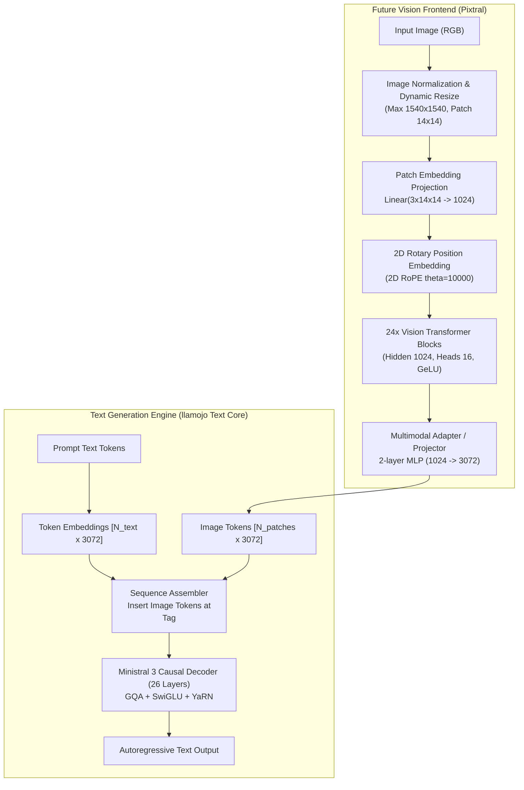

# Feasibility Study & Implementation Roadmap: Ministral 3 3B in `llamojo`

## 1. Executive Summary

This document presents a technical study and implementation roadmap for supporting Mistral AI's **Ministral 3 3B** model (`Ministral-3-3B-Instruct-2512` and base variants) within the pure-Mojo **`llamojo`** inference framework.

Ministral 3 3B is a compact, high-performance edge model featuring:
1. A **dense text backbone** (~3.4B parameters) with Grouped-Query Attention (GQA), RMSNorm, SwiGLU activations, and long-context capabilities (up to 256k tokens) enabled by **YaRN RoPE**.
2. A **multimodal vision branch** (~400M parameters) based on the Pixtral architecture (spatial patch projection, 2D RoPE, and a vision-language projection stem).

### Key Takeaways & Feasibility
* **Text-Only Processing Feasibility**: **Very High (Quick Time-to-Market)**. `llamojo` already provides ~85% of the necessary kernels and infrastructure: GQA prefill/decode, RMSNorm, SwiGLU, SIMD quantized matrix multiplications (`Q4_K`, `Q5_K`, `Q8_0`, etc.), GGUF v2/v3 parsing, and thread pool orchestration. Only four targeted enhancements are needed: GGUF architecture dispatch, YaRN RoPE scaling, Sliding Window Attention wiring, and 131k Tekken tokenizer verification.
* **Multimodal (Vision) Feasibility**: **Moderate Effort (Recommended for Phase 4)**. Adding image-to-text processing requires implementing the Pixtral vision encoder, image patch extraction, and embedding concatenation into the autoregressive text pipeline.

---

## 2. Architectural Comparison: Ministral 3 3B vs. `llamojo` Current Engine

| Architectural Feature | Ministral 3 3B Specification | `llamojo` Current Capabilities | Compatibility Status |
| :--- | :--- | :--- | :--- |
| **GGUF Identifier** | `general.architecture = "mistral3"` / `"ministral3"` | Recognizes `"llama"`, `"gemma"`, `"gemma4"`, etc. | ⚠️ **Needs Mapping**: Add `"mistral3"` to metadata parser in `gguf.mojo`. |
| **Layers / Hidden Dim** | 26 layers, $d_{\text{model}} = 3072$ | Arbitrary layer counts and dims supported | ✅ **Fully Compatible** |
| **MLP / Intermediate Dim** | SwiGLU, $d_{\text{ffn}} = 9216$ | SwiGLU (`fused_silu_mul`) + parallel GEMM | ✅ **Fully Compatible** |
| **Attention Mechanism** | GQA (32 Query heads, 8 KV heads, $d_{\text{head}} = 128$) | GQA decode (`gqa_decode`) and prefill | ✅ **Fully Compatible** |
| **Normalization** | RMSNorm ($\epsilon = 10^{-5}$) | SIMD-vectorized `rms_norm` with dynamic $\epsilon$ | ✅ **Fully Compatible** |
| **Tied Word Embeddings** | `tie_word_embeddings = true` (or explicit output weight) | Supported via `cfg.is_tied_embeddings` | ✅ **Fully Compatible** |
| **Positional Embeddings** | **YaRN RoPE** (factor=16.0, beta_fast=32, beta_slow=1, $\theta = 10^6$) | Standard RoPE & linear scale (`rope_freq_scale`) | ⚠️ **Missing Operator**: YaRN frequency blending missing for full 256k context. |
| **Sliding Window (SWA)** | Layer-dependent or global SWA (optional depending on quant) | SWA kernel exists in `kernels_attn.mojo`, but unwired in `models.mojo` | ⚠️ **Integration Needed**: Wire `sliding_window` parameter to decoder layer. |
| **Tokenizer** | 131,072 tokens (Mistral Tekken / Byte-level BPE) | GPT-2 BPE, SentencePiece, Gemma tokenizers | ⚠️ **Validation Needed**: Ensure GGUF BPE table loader handles 131k entries cleanly. |
| **Multimodal Vision** | Pixtral Vision Encoder (14x14 patches, 24 layers, $d=1024$) | No vision encoder (Audio/Whisper exists) | ❌ **Deferred**: Vision frontend and projector required for multimodal. |

---

## 3. Detailed Gap Analysis for Text-Only Inference

### 3.1 GGUF Metadata Ingestion (`src/llamojo/gguf.mojo`)
In GGUF files produced by `llama.cpp` or Hugging Face converters, the architecture is stored as `mistral3` or `ministral3`.
- **Existing Behavior**: `build_model_config()` looks for `arch + ".attention.head_count"`, etc. It handles specific overrides only for `"gemma4"`.
- **Action**: Ensure `gguf.mojo` reads:
  - `{arch}.rope.scaling.type = "yarn"`
  - `{arch}.rope.scaling.factor` ($16.0$)
  - `{arch}.rope.scaling.beta_fast` ($32.0$)
  - `{arch}.rope.scaling.beta_slow` ($1.0$)
  - `{arch}.rope.scaling.original_context_length` ($16384$)
  - `{arch}.attention.sliding_window`

### 3.2 YaRN Rotary Position Embeddings (`src/llamojo/backend/kernels_norm_rope.mojo`)
Standard RoPE calculates frequency $\theta_i = \text{rope\_theta}^{-2i / d}$.
Linear scaling multiplies position or divides frequency by a constant factor $s$.
However, YaRN (Yet another RoPE extensioN) partitions frequencies into three distinct wavelength regimes based on ratios between wavelength and original context length $L_0$:
1. **Low frequencies (long wavelengths)**: Scaled by $s$ (interpolation).
2. **High frequencies (short wavelengths)**: Not scaled (extrapolation, scale = 1).
3. **Mid frequencies**: Smooth ramp between extrapolation and interpolation using $\beta_{\text{fast}}$ and $\beta_{\text{slow}}$, combined with an attention temperature correction factor $\sqrt{1 / t}$ (where $t = 0.1 \ln(s) + 1.0$).

Without YaRN:
- Short context sequences ($< 16\text{k}$ tokens) will run accurately under standard RoPE.
- Extended contexts (up to $256\text{k}$ tokens) will experience severe perplexity explosion unless YaRN frequency adjustments are computed during RoPE application.

### 3.3 Wiring Sliding Window Attention into Dense Layers (`src/llamojo/backend/models.mojo`)
- In `kernels_attn.mojo:gqa_decode`, the sliding window check is already implemented:
  ```mojo
  if sliding_window > 0 and pos >= sliding_window:
      start_t = pos - sliding_window + 1
  ```
- However, `models.mojo:forward_layer_dense` currently calls `gqa_decode` without forwarding `cfg.sliding_window`:
  ```mojo
  gqa_decode(
      q, layer_k_cache_base, layer_v_cache_base, att_buf, xb,
      pos, n_heads, n_kv_heads, head_dim, max_ctx, h0, h1,
  )
  ```
- **Action**: Pass `sliding_window=cfg.sliding_window` to `gqa_decode`.

### 3.4 131k Vocab & Tekken Tokenizer Compatibility (`src/llamojo/vocab.mojo`)
Ministral 3 utilizes a 131,072 vocabulary size based on Tekken (byte-level BPE with special control tokens for tool calling and reasoning).
- `llamojo` must parse the GGUF arrays:
  - `tokenizer.ggml.tokens`
  - `tokenizer.ggml.scores` (handling float or integer score encodings without overflow)
  - `tokenizer.ggml.token_type`
- In `llama.cpp` PR #27260, integer token scores in Ministral GGUFs caused parsing failures in older loaders. `llamojo`'s `gguf.mojo` must safely convert token scores regardless of whether they are serialized as `Float32` or `Int32`.

---

## 4. Recommended Implementation Phases (Text-Only Processing)

### Phase 1: GGUF Ingestion & Architecture Configuration
* **Goal**: Enable `llamojo` to load Ministral 3 GGUF files into `ModelConfig` and allocate memory correctly.
* **Tasks**:
  1. Add `mistral3` and `ministral3` to `gguf.mojo` recognized architecture list.
  2. Parse YaRN parameters (`beta_fast`, `beta_slow`, `rope_scaling_factor`, `orig_ctx_len`) and populate `ModelConfig`.
  3. Validate tensor name mappings (`blk.i.attn_q.weight`, `blk.i.attn_k.weight`, `blk.i.attn_v.weight`, `blk.i.attn_output.weight`, `blk.i.ffn_gate.weight`, `blk.i.ffn_up.weight`, `blk.i.ffn_down.weight`, `output.weight` or tied `token_embd.weight`).
  4. Write a unit test `test_ministral3_gguf_metadata.mojo` using synthetic or sampled GGUF headers.

### Phase 2: YaRN RoPE Kernel Implementation
* **Goal**: Accurate position encodings for sequences from 1 token to 256k tokens.
* **Tasks**:
  1. Implement `apply_rope_yarn` in `src/llamojo/backend/kernels_norm_rope.mojo`:
     - Calculate wavelength per head dimension index: $\lambda = 2\pi / \theta_i$.
     - Compute smooth interpolation weight $\gamma(r) \in [0, 1]$ based on $(\text{low\_cutoff}, \text{high\_cutoff})$.
     - Apply temperature dampening factor to attention scores or query/key scaling.
  2. Integrate `apply_rope_yarn` into `models.mojo:forward_layer_dense` when `cfg.rope_scaling_type == YARN`.
  3. Unit test against PyTorch reference outputs for varying sequence positions.

### Phase 3: Attention Window Wiring & Pipeline Validation
* **Goal**: Complete end-to-end text generation on CPU.
* **Tasks**:
  1. Connect `cfg.sliding_window` parameter to `gqa_decode` and `gqa_prefill` inside `models.mojo`.
  2. Support tied embeddings in `llama.mojo:forward` (if `model[].output_weight` is null, reuse `model[].token_embd`).
  3. Verify tokenizer decoding of control tokens (`[INST]`, `[/INST]`, `<s>`, `</s>`, and tool call markers).
  4. Run inference benchmarks on `Ministral-3-3B-Instruct-2512-Q4_K_M.gguf` measuring prompt eval (PP) and token generation (TG) tokens/sec on AVX-512 / AVX2.

---

## 5. Architectural Blueprint for Future Image-to-Text (Multimodal) Processing

Ministral 3 is natively multimodal when equipped with the **Pixtral** vision encoder. For future expansion beyond text-only, the following components should be developed:



### Key Recommendations for Multimodal Implementation
1. **GGUF Multimodal Projector (`mmproj`) Loader**:
   - Follow `llama.cpp`'s `llama-mtmd` structure by allowing `llamojo` to load an accompanying `mmproj-*.gguf` containing `v.patch_embd`, `v.blk.*`, and `mm.*` tensors.
2. **Dynamic 2D Patch Tiling & 2D RoPE**:
   - Unlike standard ViT (fixed square images), Pixtral supports variable aspect ratios up to 1540px. Implement 2D coordinate-based RoPE where patch frequencies are decoupled into $(x, y)$ spatial dimensions.
3. **Prefix Embedding Injection**:
   - In `llama.mojo`, expand `llama_batch` to support pre-computed hidden states ($[N_{\text{image\_tokens}}, d_{\text{model}}]$) directly into `ctx.x` before decoding starts, replacing placeholder image tokens.
4. **Leverage Existing Whisper Infrastructure**:
   - The modular design of `llamojo/whisper` (which already implements LayerNorm, 1D/2D convolution layers, and encoder-decoder interaction patterns) provides an architectural blueprint for structuring `llamojo/vision/pixtral.mojo`.

---

## 6. Conclusion & Action Plan

Running **Ministral 3 3B text-only** in `llamojo` is immediately feasible with high performance and low implementation friction. The model fits directly into `llamojo`'s existing GQA transformer architecture with only minimal adjustments for GGUF metadata tags, YaRN RoPE, and attention window passing.

* **Immediate Next Steps**: Execute **Phase 1** (GGUF architecture detection and 131k vocab testing) followed by **Phase 2 & 3** (YaRN RoPE and sliding window verification).
* **Future Work**: Schedule the Pixtral vision encoder (Phase 4) as a dedicated multimodal milestone once text inference is stabilized.
