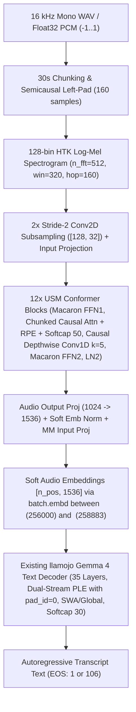
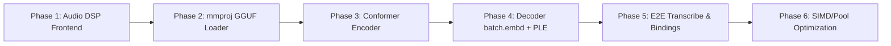

# Pure-Mojo Gemma 4 E2B Audio Transcription Implementation Plan

This document specifies the phased architecture and implementation plan for adding native, zero-dependency **Gemma 4 E2B audio transcription (ASR)**, speech translation (S2TT), and speech understanding to **`llamojo`**.

Unlike Whisper's standalone encoder-decoder ASR architecture, Gemma 4 E2B (`google/gemma-4-e2b-it`) embeds a ~300M-parameter **USM-style Conformer audio tower** (`gemma4_audio` / `PROJECTOR_TYPE_GEMMA4A`) whose projected embeddings feed directly into the existing **Gemma 4 text decoder** already implemented in [`src/llamojo/backend/gemma4.mojo`](./../src/llamojo/backend/gemma4.mojo).

---

## 1. Executive Summary & End-to-End Architecture

### 1.1 Scope & Projector Variants

Gemma 4 uses two distinct audio projector types in upstream `llama.cpp` (`tools/mtmd`):
- **`gemma4a` (`PROJECTOR_TYPE_GEMMA4A`)**: The 12-layer USM Conformer encoder + subsampling Conv2D + multimodal projection used by **Gemma 4 E2B** and **Gemma 4 E4B**. **This is the target of this plan.**
- **`gemma4ua` (`PROJECTOR_TYPE_GEMMA4UA`)**: An encoder-free raw-waveform (640-sample) projection used by unified Gemma 4 models (`clip_graph_gemma4ua`). Out of scope for E2B, though the `batch.embd` decoder hook in Phase 4 supports both.

### 1.2 End-to-End Inference Pipeline

### 1.3 Proposed Module Layout

Mirroring `src/llamojo/whisper/`, the Gemma 4 audio subsystem will live in a dedicated package `src/llamojo/gemma4_audio/` plus targeted updates to the Gemma 4 decoder and public bindings:

| Path | Responsibility | Status |
| :--- | :--- | :--- |
| `src/llamojo/gemma4_audio/__init__.mojo` | Public package exports | Planned |
| `src/llamojo/gemma4_audio/frontend.mojo` | 16 kHz mono WAV/PCM loader, 512-pt FFT, 128-bin HTK log-mel spectrogram, semicausal padding, 30 s chunking | Planned |
| `src/llamojo/gemma4_audio/mmproj.mojo` | `mmproj` GGUF parser, `Gemma4AudioConfig`, `Gemma4AudioWeights`, `ClampInfo` table | Planned |
| `src/llamojo/gemma4_audio/conformer.mojo` | 2D subsampling Conv, `ClippableLinear`, 12 Conformer blocks, chunked causal RPE attention, causal depthwise Conv1D, multimodal projection | Planned |
| `src/llamojo/gemma4_audio/transcribe.mojo` | Gemma 4 turn prompt builder (`<boa>`/`<eoa>`), chunk orchestration, mixed `llama_decode` prefill + sampling loop | Planned |
| [`src/llamojo/backend/gemma4.mojo`](./../src/llamojo/backend/gemma4.mojo) | Add `batch.embd` unscaled input path & `token=0` PLE lookup (`forward_gemma4_single_embd`) | Existing (Update) |
| [`src/llamojo/llama.mojo`](./../src/llamojo/llama.mojo) | Dispatch `batch.embd` vs `batch.token` in the `cfg.arch == "gemma4"` branch of `llama_decode` | Existing (Update) |
| [`src/llamojo/c_api.mojo`](./../src/llamojo/c_api.mojo) | Expose `gemma4_audio_init_from_file`, `gemma4_audio_free`, `gemma4_audio_encode_wav`, `gemma4_audio_transcribe_wav` | Existing (Update) |
| `python/llamojo/gemma4_audio.py` & `_lib.py` | Python wrapper and `ctypes` C-ABI bindings | Existing / Planned |

---

## 2. Verified Model & `mmproj` Specifications

All architectural constants and tensor names below are verified directly against:
- Local HF checkpoint config: `google/gemma-4-e2b-it/config.json`
- Local `llama.cpp` reference (`b11913`): `tools/mtmd/mtmd-audio.cpp`, `tools/mtmd/clip.cpp`, `tools/mtmd/clip-impl.h`, `tools/mtmd/models/gemma4a.cpp`, `gguf-py/gguf/tensor_mapping.py`, and `src/models/gemma4.cpp`.

### 2.1 `Gemma4AudioFeatureExtractor` DSP Parameters vs. Whisper

| Parameter | Gemma 4 E2B (`gemma4a`) | Whisper (`src/llamojo/whisper/audio.mojo`) | Notes |
| :--- | :--- | :--- | :--- |
| **Sample Rate** | `16000` Hz (mono Float32 in `[-1, 1]`) | `16000` Hz | Reuse WAV/PCM loader from `whisper/audio.mojo` |
| **Mel Bins (`feature_size`)** | `128` | `80` / `128` | `128` filterbank channels (`0.0` to `8000.0` Hz) |
| **Window Length** | `320` samples (20 ms) | `400` samples (25 ms) | Periodic Hann window (`0.5 - 0.5*cos(2*pi*i/320)`), **zero-padded to 512** |
| **FFT Size (`n_fft`)** | `512` (`257` frequency bins) | `400` (`201` frequency bins) | Power-of-2 radix-2 FFT directly applicable (`512 = 2^9`) |
| **Hop Length** | `160` samples (10 ms) | `160` samples (10 ms) | Identical hop |
| **Mel Scale** | **HTK**, no Slaney area norm (`scale = 1.0`) | Slaney | Must build HTK mel filterbank matrix |
| **Spectrum & Log** | **Magnitude** (`use_magnitude = true`), **natural log** (`ln(max(mel, 0.001))`) | Power spectrum (`\|X\|^2`), `log10` + Whisper clamp/norm | `mel_floor = 0.001f`, `norm_per_feature = false` |
| **Preemphasis** | `0.0` (disabled) | `0.0` | No preemphasis filter |
| **Padding & Chunking** | 30 s chunks (`480,000` samples); semicausal left-pad `pad_left = 160` (`center_padding = false`); `pt_frames = (chunk_len + 160 - 321) / 160 + 1` | 30 s zero-padded to 3,000 frames, centered | Each 30 s chunk produces ~`3,000` mel frames $\rightarrow$ ~`750` audio tokens after 4x subsampling |

### 2.2 Gemma 4 Audio & Text Hyperparameters (`config.json`)

- **Audio Tower (`audio_config`, `model_type = "gemma4_audio"`)**:
  - `hidden_size = 1024`, `num_hidden_layers = 12`, `num_attention_heads = 8` (`d_head = 128`)
  - `subsampling_conv_channels = [128, 32]`
  - `attention_chunk_size = 12`, `attention_context_left = 13`, `attention_context_right = 0`
  - `attention_logit_cap = 50.0`, `attention_invalid_logits_value = -1e9`
  - `conv_kernel_size = 5`, `hidden_act = "silu"`, `residual_weight = 0.5`, `rms_norm_eps = 1e-6`
  - `output_proj_dims = 1536`, `use_clipped_linears = true`
- **Text Decoder Integration (`text_config` & root `config.json`)**:
  - `text_config.hidden_size = 1536`, `hidden_size_per_layer_input = 256`, `num_hidden_layers = 35`
  - Special token IDs: `bos_token_id = 2`, `pad_token_id = 0`, `boa_token_id = 256000`, `audio_token_id = 258881`, `eoa_token_id = 258883`, `eos_token_id = [1, 106]`

### 2.3 Complete `mmproj` GGUF Tensor Inventory (`PROJECTOR_TYPE_GEMMA4A`)

Audio prefix is `"a"` and Conformer block index is `il` $\in \{0 \dots 11\}$:

| Component | `mmproj` GGUF Tensor Name | HF Checkpoint Origin | Notes / Shape |
| :--- | :--- | :--- | :--- |
| **Subsampling** | `a.conv1d.{0,1}.weight`, `.bias` | `conformer.subsample_conv_projection.layer{0,1}.conv` | 2D stride-2 conv (`k=3, p=1`), channels `1 -> 128 -> 32` |
| | `a.conv1d.{0,1}.norm.weight` | `conformer.subsample_conv_projection.layer{0,1}.norm` | `nn.LayerNorm(channels)` (no bias) |
| | `a.input_projection.weight`, `.bias` | `conformer.subsample_conv_projection.input_proj_linear` | `[32 * 32 = 1024, 1024]` (`ClippableLinear`) |
| **FFN 1 (half-step)** | `a.blk.{il}.ffn_norm.weight` | `conformer.layers.{il}.feed_forward1.pre_layer_norm` | RMSNorm `[1024]` |
| | `a.blk.{il}.ffn_up.weight`, `.bias` | `conformer.layers.{il}.feed_forward1.ffw_layer_1` | `1024 -> 4096` (`ClippableLinear`, SiLU) |
| | `a.blk.{il}.ffn_down.weight`, `.bias` | `conformer.layers.{il}.feed_forward1.ffw_layer_2` | `4096 -> 1024` (`ClippableLinear`) |
| | `a.blk.{il}.ffn_post_norm.weight` | `conformer.layers.{il}.feed_forward1.post_layer_norm` | RMSNorm `[1024]` |
| **Chunked Self-Attn** | `a.blk.{il}.attn_pre_norm.weight` *(fallback `a.blk.{il}.ln1.weight`)* | `conformer.layers.{il}.norm_pre_attn` | RMSNorm `[1024]` |
| | `a.blk.{il}.attn_{q,k,v}.weight` | `conformer.layers.{il}.self_attn.{q,k,v}_proj` | `1024 -> 1024` (`ClippableLinear`) |
| | `a.blk.{il}.per_dim_scale.weight` | `conformer.layers.{il}.attention.attn.per_dim_scale` | `[128]` |
| | `a.blk.{il}.per_dim_k_scale.weight` | `conformer.layers.{il}.attention.attn.per_dim_key_scale` | `[128]` |
| | `a.blk.{il}.attn_k_rel.weight` | `conformer.layers.{il}.self_attn.relative_k_proj` | `1024 -> 1024` (`[1024, 1024]`) |
| | `a.blk.{il}.attn_out.weight`, `.bias` | `conformer.layers.{il}.self_attn.post` | `1024 -> 1024` (`ClippableLinear`) |
| | `a.blk.{il}.attn_post_norm.weight` | `conformer.layers.{il}.norm_post_attn` | RMSNorm `[1024]` |
| **Conv Module** | `a.blk.{il}.conv_norm.weight`, `.bias` | `conformer.layers.{il}.lconv1d.pre_layer_norm` | **Pre-conv RMSNorm** (swapped name in GGUF!) |
| | `a.blk.{il}.conv_pw1.weight`, `.bias` | `conformer.layers.{il}.lconv1d.linear_start` | `1024 -> 2048` (GLU splits `1024 * sigmoid(1024)`) |
| | `a.blk.{il}.conv_dw.weight`, `.bias` | `conformer.layers.{il}.lconv1d.depthwise_conv1d` | Causal depthwise Conv1D (`k=5`, `[5, 1024]`) |
| | `a.blk.{il}.norm_conv.weight`, `.bias` | `conformer.layers.{il}.lconv1d.conv_norm` | **Post-depthwise RMSNorm** (swapped name in GGUF!) |
| | `a.blk.{il}.conv_pw2.weight`, `.bias` | `conformer.layers.{il}.lconv1d.linear_end` | `1024 -> 1024` (`ClippableLinear`) |
| **FFN 2 (half-step)** | `a.blk.{il}.ffn_norm_1.weight` | `conformer.layers.{il}.feed_forward2.pre_layer_norm` | RMSNorm `[1024]` |
| | `a.blk.{il}.ffn_up_1.weight`, `.bias` | `conformer.layers.{il}.feed_forward2.ffw_layer_1` | `1024 -> 4096` (`ClippableLinear`, SiLU) |
| | `a.blk.{il}.ffn_down_1.weight`, `.bias` | `conformer.layers.{il}.feed_forward2.ffw_layer_2` | `4096 -> 1024` (`ClippableLinear`) |
| | `a.blk.{il}.ffn_post_norm_1.weight` | `conformer.layers.{il}.feed_forward2.post_layer_norm` | RMSNorm `[1024]` |
| **Block Output Norm** | `a.blk.{il}.ln2.weight` | Conformer block post-FFN2 norm | RMSNorm `[1024]` |
| **Output & MM Embed** | `a.pre_encode.out.weight`, `.bias` | `model.audio_tower.output_proj` | `1024 -> 1536` (`ClippableLinear`) |
| | `mm.a.soft_emb_norm.weight` | `model.embed_audio.soft_embedding_norm` | RMSNorm `[1536]` |
| | `mm.a.input_projection.weight` | `model.embed_audio.embedding_projection` | `1536 -> 1536` |
| **Clippable Scalars** | `<name>.input_min`, `.input_max`, `.output_min`, `.output_max` | `ClippableLinear` buffers | Optional scalar tensors per `.weight` |

---

## 3. Phased Implementation Plan

---

### Phase 1: Gemma 4 Audio DSP Frontend (`src/llamojo/gemma4_audio/frontend.mojo`)

**Objective:** Implement a pure-Mojo audio preprocessor matching `Gemma4AudioFeatureExtractor` and `llama.cpp`'s `mtmd_audio_preprocessor_gemma4a`.

**Deliverables:**
1. **WAV & PCM Reuse**: Reuse `load_wav_file` / 16 kHz mono normalization from [`src/llamojo/whisper/audio.mojo`](./../src/llamojo/whisper/audio.mojo) (and add stereo-to-mono averaging / resampling guard if needed).
2. **HTK Mel Filterbank (`128 × 257`)**:
   - Implement `init_gemma4_mel_filters(n_mel=128, n_fft=512, sample_rate=16000)` using the **HTK** formula $m = 2595 \cdot \log_{10}(1 + f / 700)$ over `[0, 8000]` Hz with **no Slaney area normalization** (`scale = 1.0`).
3. **512-Point Radix-2 FFT & Zero-Padded Hann Window**:
   - Build a `512`-sample periodic Hann cache where indices `0..319` are `0.5 - 0.5 * cos(2 * pi * i / 320)` and indices `320..511` are `0.0`.
   - Implement a fast radix-2 Cooley-Tukey FFT of size `512` (power of 2, simpler and faster than Whisper's mixed-radix `400`-point FFT).
   - Compute **magnitude** spectrum $\sqrt{\text{re}^2 + \text{im}^2}$ (not squared power), multiply by the `128 × 257` mel matrix, and take $\ln(\max(\text{mel}, 0.001))$.
4. **30-Second Chunking & Semicausal Padding**:
   - Split input PCM into `480,000`-sample (30 s) chunks.
   - Left-pad each chunk by `pad_left = 160` zeros (`center_padding = false`), compute exact PyTorch frame count `pt_frames = (chunk_len + 160 - 321) // 160 + 1`, right-pad so `(pt_frames - 1) * 160 + 512` samples are available, and trim output to `[128, pt_frames]`.

**Verification Gate:**
- Create `tests/test_gemma4_audio_frontend.mojo`.
- Compare generated `[128, n_frames]` log-mel tensors on a 1 kHz sine wave and a real speech `.wav` against reference values dumped from `mtmd_audio_preprocessor_gemma4a` / HF `Gemma4AudioFeatureExtractor` (max abs error $< 10^{-4}$).

---

### Phase 2: `mmproj` GGUF Loader & `ClippableLinear` Registry (`src/llamojo/gemma4_audio/mmproj.mojo`)

**Objective:** Load `gemma4a` `mmproj` GGUF weights in pure Mojo with zero external dependencies using [`GGUFContext`](./../src/llamojo/gguf.mojo).

**Deliverables:**
1. **`Gemma4AudioConfig` & Validation**:
   - Read `clip.projector_type` (require `"gemma4a"`), `clip.has_audio_encoder`, `clip.audio.embedding_length` (`1024`), `clip.audio.block_count` (`12`), `clip.audio.attention.head_count` (`8`), `clip.audio.num_mel_bins` (`128`), and projection output dimension.
   - **Hardcode `norm_eps = 1e-6f`** regardless of GGUF metadata (reproducing `llama.cpp`'s fix for early converted files with incorrect `rms_norm_eps`).
2. **Tensor Binding (`Gemma4AudioWeights`)**:
   - Subsampling: `a.conv1d.{0,1}.{weight,bias}`, `a.conv1d.{0,1}.norm.weight`, `a.input_projection.{weight,bias}`.
   - 12 Conformer blocks (`a.blk.{il}.*`): bind all FFN1, Attention, Conv, FFN2, and `ln2` weights/biases. Explicitly map `a.blk.{il}.conv_norm.*` to `norm_conv` (pre-conv RMSNorm) and `a.blk.{il}.norm_conv.*` to `conv_norm` (post-depthwise RMSNorm) to match upstream `tensor_mapping.py`.
   - Output & multimodal projection: `a.pre_encode.out.{weight,bias}`, `mm.a.soft_emb_norm.weight`, `mm.a.input_projection.weight`.
3. **`ClippableLinear` Clamp Metadata Table**:
   - Iterate all loaded `.weight` tensor names and look up `<name>.input_min`, `<name>.input_max`, `<name>.output_min`, `<name>.output_max` scalars (defaulting to `[-FLT_MAX, +FLT_MAX]`). Store in a fast per-tensor `ClampInfo` struct attached to each weight handle.

**Verification Gate:**
- Create `tests/test_gemma4_mmproj_loader.mojo`.
- Verify synthetic GGUF loading and run an inventory + shape check against an actual `gemma-4-E2B-it` `mmproj` GGUF file (all expected tensors bound, clamp ranges parsed, swapped conv norms verified).

---

### Phase 3: Pure-Mojo Conformer Encoder & Multimodal Projector (`src/llamojo/gemma4_audio/conformer.mojo`)

**Objective:** Implement the exact `clip_graph_gemma4a` forward computation in pure Mojo.

**Deliverables:**
1. **`clippable_matmul` Primitive**:
   - Support F32, F16, BF16, and quantized weight rows via [`src/llamojo/backend/kernels_quant.mojo`](./../src/llamojo/backend/kernels_quant.mojo).
   - Clamp activation vector $x$ to `[input_min, input_max]` before dot products and clamp outputs to `[output_min, output_max]` when `ClampInfo` is active.
2. **2D Conv Subsampling Frontend**:
   - Input `[128, n_frames]` treated as `[freq=128, time=n_frames, ch=1]`.
   - Two `Conv2D(k=3x3, stride=2, pad=1)` passes (`1 -> 128 -> 32`), each followed by `nn.LayerNorm(channels, eps=1e-6)` across channels and `ReLU`.
   - Output temporal length: $n_{\text{pos}} = \lfloor (\lfloor (n_{\text{frames}} - 1) / 2 \rfloor + 1 - 1) / 2 \rfloor + 1$ (freq reduces $128 \to 64 \to 32$).
   - Flatten `[ch * freq, time]` (`1024 × n_pos`) and apply `a.input_projection`.
3. **Sinusoidal RPE & Blocked Causal Mask**:
   - Precompute `pos_emb[13, 1024]` for relative offsets `[12, 11, ..., 0]` with `num_timescales = 512`, $\Delta = \ln(10000) / 511$, storing $[\sin(\text{pos} \cdot \text{inv\_ts}), \cos(\text{pos} \cdot \text{inv\_ts})]$.
   - Build blocked causal mask `kq_mask[S=24, C=12, B]` where $B = \lceil n_{\text{pos}} / 12 \rceil$, setting `0.0` when `gq < n_pos && 0 <= gk < n_pos && gk <= gq && (gq - gk) < 12`, else `-1e9`.
4. **12-Layer USM Conformer Loop (`il = 0..11`)**:
   - **FFN 1 (half-step)**: `RMSNorm(x, ffn_norm) -> ClippableLinear(ffn_up) -> SiLU -> ClippableLinear(ffn_down) -> RMSNorm(ffn_post_norm)`, add `0.5 * out` to residual.
   - **Chunked Causal Self-Attention** (`C=12, P=12, S=24, R=13`, `n_head=8, d_head=128`):
     - `RMSNorm(residual, attn_pre_norm)`.
     - Project $Q, K, V$ via `ClippableLinear`; reshape to `[128, 8, n_pos]`.
     - Scale $Q$ by $\frac{1}{\sqrt{128} \cdot \ln 2} \cdot \text{per\_dim\_scale}$, and $K$ by $\frac{\ln(1 + e)}{\ln 2} \cdot \text{per\_dim\_k\_scale}$.
     - Partition $Q$ into `B` blocks of `C=12`, and extract overlapping `S=24` context windows for $K, V$ (`[P=12]` left-pad, stride `C=12`).
     - Compute content scores $Q K^T$ + relative scores $Q (\text{attn\_k\_rel} \cdot \text{pos\_emb})^T$ with Transformer-XL blocked relative shift.
     - Apply logit softcap $50.0 \cdot \tanh(\text{scores} / 50.0)$, add `kq_mask`, softmax, multiply by $V$, trim padding back to `n_pos`, project via `attn_out`, apply `attn_post_norm`, add to residual.
   - **Causal Depthwise Convolution Module**:
     - `RMSNorm(residual, conv_norm)` (pre-conv norm) $\rightarrow$ `conv_pw1` (`1024 -> 2048`) $\rightarrow$ GLU (`x[0:1024] * sigmoid(x[1024:2048])`).
     - Left-pad by `4` zeros along time, run causal depthwise `Conv1D` (`k=5`, `conv_dw`), apply `norm_conv` (post-dw RMSNorm), `SiLU`, `conv_pw2`, add to residual.
   - **FFN 2 (half-step)** + **Block Output Norm (`ln2`)**: identical half-step FFN with `*_1` weights, followed by `RMSNorm(..., ln2)`.
5. **Output & Multimodal Projection**:
   - `a.pre_encode.out` (`1024 -> 1536`) $\rightarrow$ `RMSNorm(1e-6) * mm.a.soft_emb_norm` $\rightarrow$ `mm.a.input_projection` (`1536 -> 1536`), returning `[n_pos, 1536]` soft audio embeddings.

**Verification Gate:**
- Create `tests/test_gemma4_conformer.mojo`.
- Compare the `[n_pos, 1536]` soft audio embeddings on a test WAV file against `llama.cpp` `mtmd` (`clip_image_f32` / `mtmd_encode_chunk`): cosine similarity $> 0.999$, max elementwise diff $< 10^{-2}$.

---

### Phase 4: Multimodal Embedding Injection (`batch.embd`) in Gemma 4 Text Decoder

**Objective:** Enable [`src/llamojo/llama.mojo`](./../src/llamojo/llama.mojo) and [`src/llamojo/backend/gemma4.mojo`](./../src/llamojo/backend/gemma4.mojo) to accept precomputed soft embeddings (`batch.embd`) alongside standard text tokens (`batch.token`).

**Deliverables:**
1. **Unscaled Embedding Entry in `forward_gemma4_single_embd` (or parameterized `forward_gemma4_single_token`)**:
   - Currently [`forward_gemma4_single_token`](./../src/llamojo/backend/gemma4.mojo#L57-L120) always dequantizes `token_embd[token]` and multiplies by $\sqrt{1536}$.
   - For multimodal embedding rows (`Int(batch.embd) != 0`), copy the `1536` floats directly from `batch.embd + tok_idx * dim` into `x` **without** $\sqrt{\text{dim}}$ scaling (matching `llama.cpp` [`src/models/gemma4.cpp:170-171`](file:///mnt/c/Documents/Programming/llama.cpp/src/models/gemma4.cpp#L170-L171)).
2. **PLE Padding Token Lookup (`token_id = 0`)**:
   - During Step 2 (Dual-Stream PLE) for multimodal embedding positions, look up row `0` (`pad_token_id = 0`) in `per_layer_token_embd`, scale by $\sqrt{256} = 16.0$, and fuse with $\text{RMSNorm}((x \cdot \text{per\_layer\_model\_proj}) / \sqrt{1536})$ via $(\text{proj} + \text{tok\_embd}) / \sqrt{2}$ (matching `llama.cpp` [`src/models/gemma4.cpp:493-504`](file:///mnt/c/Documents/Programming/llama.cpp/src/models/gemma4.cpp#L493-L504)).
3. **Batch Dispatch in `llama_decode`**:
   - Update [`src/llamojo/llama.mojo:628-690`](./../src/llamojo/llama.mojo#L628-L690) so `cfg.arch == "gemma4"` checks `Int(batch.embd) != 0` just like the dense LLaMA/Mistral loop at line 699, and supports passing mixed text-token and audio-embedding segments sequentially into the same KV cache.

**Verification Gate:**
- Create `tests/test_gemma4_embd_decode.mojo`: feed a text token's scaled embedding via `batch.embd` (when testing text-only equivalence) and verify logit parity, and verify zero regression on all existing Gemma 4 text tests.

---

### Phase 5: End-to-End Transcription Pipeline, C-ABI & Python Bindings

**Objective:** Deliver a usable end-to-end audio transcription API in Mojo, C-ABI, and Python.

**Deliverables:**
1. **`src/llamojo/gemma4_audio/transcribe.mojo`**:
   - Construct Gemma 4 chat turns for ASR:
     1. Text prefix: `<bos>` (`2`) + `<start_of_turn>user\n` + `<boa>` (`256000`).
     2. Soft audio tokens: `n_pos` embeddings from Phase 3 via `batch.embd`.
     3. Text suffix: `<eoa>` (`258883`) + instruction prompt (e.g., *"Transcribe the following speech segment in {language} into {language} text. Only output the transcription, with no newlines."*) + `<end_of_turn>\n<start_of_turn>model\n`.
   - Support multi-chunk (>30 s) audio by clearing/resetting KV cache per 30 s chunk (or sliding prompt reuse) and concatenating segment transcripts.
   - Run greedy/top-p autoregressive decoding until `eos_token_id` (`1` or `106`).
2. **C-ABI & Python API**:
   - Add `gemma4_audio_init_from_file(model_path, mmproj_path, n_threads)`, `gemma4_audio_free`, `gemma4_audio_encode_wav`, and `gemma4_audio_transcribe_wav` to [`src/llamojo/c_api.mojo`](./../src/llamojo/c_api.mojo).
   - Add `Gemma4AudioTranscriber` wrapper in `python/llamojo/gemma4_audio.py` and register signatures in [`python/llamojo/_lib.py`](./../python/llamojo/_lib.py).

**Verification Gate:**
- Run end-to-end transcription parity tests on real English and Spanish WAV files against `llama.cpp` (`llama-mtmd-cli` / `llama-server --mmproj`) and verify identical/near-identical transcripts.

---

### Phase 6: Performance Optimization & Benchmarking

**Objective:** Maximize CPU throughput and minimize memory allocations for on-device execution.

**Deliverables:**
1. **Worker Pool Parallelization**: Parallelize `clippable_matmul`, `Conv2D` subsampling, and causal depthwise `Conv1D` across [`LlamaWorkerPool`](./../src/llamojo/backend/threadpool.mojo) using SIMD `F32xW` kernels.
2. **Zero-Allocation Scratch Arenas**: Pre-allocate Conformer activation buffers (`max_frames = 3000`, `max_pos = 750`) once per context and reuse across 30 s chunks.
3. **Benchmarking Suite**: Compare real-time factor (RTF) and peak RSS of `llamojo` Gemma 4 E2B vs. `llama.cpp` (`gemma4a`) and vs. `llamojo` Whisper (`ggml-small.bin` / `ggml-medium.bin`).

---

## 4. Risk Analysis & Upstream Quirks

| Risk / Quirk | Impact | Mitigation |
| :--- | :--- | :--- |
| **Swapped `conv_norm` / `norm_conv` names in GGUF** | High (Corrupted Conformer conv activations) | Follow `llama.cpp` `clip.cpp:3664-3673`: load `a.blk.{il}.conv_norm` as pre-conv norm (`norm_conv`) and `a.blk.{il}.norm_conv` as post-depthwise norm (`conv_norm`). |
| **Incorrect `rms_norm_eps` in early `mmproj` GGUFs** | High (NaNs or subtle drift) | Hardcode `norm_eps = 1e-6f` for `gemma4a` (matching `clip.cpp:2231-2233`). |
| **Missing `ClippableLinear` clamping** | High (Activation overflow / divergence) | Load `.input_min`/`.input_max`/`.output_min`/`.output_max` scalars for every `.weight` tensor and apply clamping in `clippable_matmul`. |
| **Scaling / PLE mismatch on `batch.embd`** | High (Garbled transcript output) | Do **not** scale `batch.embd` by $\sqrt{1536}$; use `pad_token_id = 0` for `per_layer_token_embd` lookup on audio positions. |
| **Quantizing 4D Conv weights in `mmproj`** | High (Assertion failure / quality loss) | Keep `mmproj` in `F16` / `BF16` / `F32` (never quantize `a.conv1d.*` or `a.blk.*.conv_dw` with block quants). |
| **30-second chunk word splitting** | Medium (Boundary word truncation) | Support optional short energy-based silence splitting (VAD) or 1–2 s overlap reconciliation in Phase 5/6 for >30 s recordings. |
