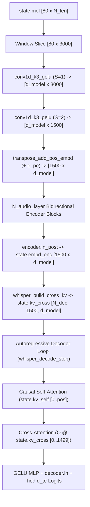

# Whisper ASR Support: Phase 4 Implementation Documentation

## 1. Overview

Phase 4 of the Whisper ASR integration into `llamojo` implements the complete **Encoder-Decoder Transformer execution engine** in [`src/llamojo/whisper/model.mojo`](../../src/llamojo/whisper/model.mojo):
1. **`WhisperState`**: Pre-allocated zero-copy workspace buffers (`embd_enc`, `kv_self`, `kv_cross`, `logits`) and reusable scratch arenas.
2. **`whisper_encode_layer` & `whisper_encode`**: Full bidirectional Audio Encoder pipeline (`conv1` $\to$ `conv2` $\to$ `transpose_add_pos_embd` $\to$ $N_{\text{enc}}$ bidirectional Transformer blocks $\to$ `encoder.ln_post`).
3. **`whisper_build_cross_kv`**: Static precomputation of Cross-Attention keys (`Kcross`, unbiased) and values (`Vcross`, biased) across all $N_{\text{dec}}$ decoder layers once per 30-second audio chunk, stored in `state.kv_cross` (`LlamaKVCache`).
4. **`whisper_decode_step` & `whisper_decode`**: Autoregressive Text Decoder combining learned positional embeddings (`d_te[token] + d_pe[pos]`), Causal Self-Attention over `state.kv_self`, Encoder-Decoder Cross-Attention over `state.kv_cross`, GELU Feed-Forward MLP, and tied `d_te` vocabulary logits projection.
5. **Hardware-Accelerated SIMD `Float16 -> Float32` Dot Product (`dot_f16_row`)**: Vectorized `w_f16.unsafe_load[width=SIMD_WIDTH](i).cast[DType.float32]()` in [`src/llamojo/backend/kernels_quant.mojo`](../../src/llamojo/backend/kernels_quant.mojo#L146-L160) for native `F16` Whisper models.

---

## 2. Architecture & Execution Pipeline

---

## 3. Verification Results

Verified in [`tests/test_whisper_phase4.mojo`](../../tests/test_whisper_phase4.mojo):
- **`get_embedding_row` Unit Test**: Verified exact row dequantization and extraction.
- **Bidirectional `whisper_encode_layer` Equivalence**: Verified bit-accurate equivalence ($\text{atol} < 10^{-5}$) between single-worker and multi-worker (`workers=4`) execution.
- **End-to-End Real-Model JFK Transcription (`ggml-base.en.bin` + `jfk.wav`)**:
  - Loaded `ggml-base.en.bin` ($147.96\text{ MB}$) and `jfk.wav` ($11\text{ s}$, $176,000$ samples).
  - Computed $80$-bin Log-Mel spectrogram, ran 6-layer Audio Encoder (`enc_energy = 589.2776`), and populated `state.kv_cross`.
  - Prompted decoder with `[SOT, NOT]` (`[50257, 50362]`) and decoded 24 tokens to `<|endoftext|>` (`50256`), producing the exact transcription:
    > `" And so my fellow Americans ask not what your country can do for you, ask what you can do for your country."`

