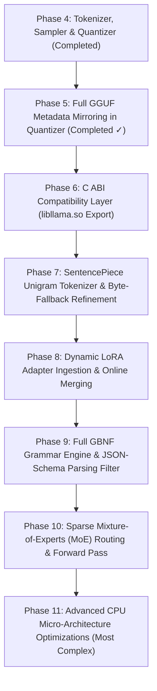

# `llamojo` Pure-CPU Extension Roadmap (Phases 5 – 11)

**Document:** `/mnt/c/Documents/Mojo/llamojo/docs/pure_cpu_extension_plan.md`  
**Status:** In Progress (Phase 5 Completed, Phases 6–11 Pending)  
**Prerequisites:** Phases 1–5 Complete (GGUF v2/v3 zero-copy loader, quantized kernels, KV cache / PagedAttention, auto-regressive multi-layer decode, BPE tokenizer, composable sampler pipeline, parallel block quantizers with full metadata preservation, CLI/Server tools).

---

## Executive Summary & Stage Ordering

This document establishes the pure-CPU implementation roadmap continuing directly from the completion of **Phase 4** (Tokenizer, Sampler & Quantizer). The stages are strictly sequenced from **easiest / lowest risk** to **most complex / architecturally involved**, systematically closing all remaining feature and performance gaps relative to upstream `llama.cpp` (`libllama`).

---

## Phase 5: Full GGUF Metadata Mirroring in Quantizer (Completed ✓)
*Complexity: Low | Risk: Very Low | Target: `src/llamojo/quantize.mojo`*

### Description
In Phase 4, `llama_model_quantize` established streaming block-quantization for tensor buffers and outputted standard GGUF v3 24-byte headers. Phase 5 completed the quantizer by preserving and transcribing the complete metadata key-value dictionary from the source model into the destination GGUF v3 container.

### Status & Verification
- **Status:** **Completed ✓**
- **Implementation:** Added full recursive GGUF value serialization (`_serialize_gguf_value`) supporting all scalar primitives (`UINT8`..`FLOAT64`, `BOOL`, `STRING`) and arrays (`STRING` token lists, `FLOAT32` scores, integer sequences).
- **Metadata Preservation:** Replicates all key-value entries from `gguf.metadata`, writes updated `general.file_type = ftype`, and inserts `general.quantization_version = 2`.
- **Stream Alignment:** Preserves strict 32-byte alignment for the header-to-tensor payload boundary and for every serialized quantized tensor.
- **Verification:** Tested in [`tests/test_vocab_sampler.mojo:test_full_metadata_quantization`](file:///mnt/c/Documents/Mojo/llamojo/tests/test_vocab_sampler.mojo), asserting all 12 metadata entries and 32 vocabulary tokens persist through `Q4_0` quantization.

### Key Objectives Achieved
1. **Metadata Serialization**:
   - Iterate over `gguf.metadata: Dict[String, GGUFValue]`.
   - Serialize keys as Pascal strings (`uint64_t len` + UTF-8 bytes).
   - Write value types (`GGUFValueType`) and raw binary values (scalars, string arrays, float arrays, int arrays).
2. **Metadata Updates**:
   - Update `general.file_type` to reflect the new quantization type ID (`ftype`).
   - Append/update `general.quantization_version = 2`.
3. **Alignment & Padding Calculation**:
   - Calculate exact header size plus metadata byte length.
   - Insert padding zeros to guarantee 32-byte alignment for the initial tensor payload data offset.
4. **Validation**:
   - Verify that quantizing a model retains its chat templates, token scores, architecture hyperparameters, and special token IDs intact.

---

## Phase 6: C Foreign Function Interface ABI Export (`libllama.so`)
*Complexity: Low to Moderate | Risk: Low | Target: `src/llamojo/c_api.mojo`*

### Description
Enable external non-Mojo binaries, Python bindings (`llama-cpp-python`), Rust crates, and C/C++ applications to consume `llamojo` as a binary drop-in replacement by exporting canonical C ABI function symbols matching `llama.h`.

### Key Objectives
1. **Native `@export` Functions**:
   - Backend lifecycle: `llama_backend_init`, `llama_backend_free`, `llama_print_system_info`.
   - Model inspection: `llama_model_load_from_file`, `llama_model_free`, `llama_model_n_vocab`, `llama_model_n_embd`, `llama_model_n_layer`, `llama_model_n_head`.
   - Context lifecycle: `llama_init_from_model`, `llama_free`, `llama_decode`, `llama_get_logits_ith`.
   - Sampling & Vocab: `llama_tokenize`, `llama_detokenize`, `llama_sampler_chain_init`, `llama_sampler_sample`.
2. **Calling Convention Compatibility**:
   - Map Mojo `Pointer` and primitive types to standard C ABI pointers and integer sizes (`int32_t`, `int64_t`, `float`, `bool`).
3. **Packaging**:
   - Add compilation configuration to generate `build/libllama.so` alongside `build/llamojo.mojoc`.

---

## Phase 7: SentencePiece Unigram Tokenizer & Tokenizer Variants
*Complexity: Moderate | Risk: Low | Target: `src/llamojo/vocab.mojo`*

### Description
While BPE covers LLaMA, Mistral, and Qwen, models such as Gemma 1 and T5 utilize the SentencePiece Unigram language model. Phase 7 implements the dynamic programming Viterbi algorithm to parse texts against Unigram vocabulary graphs.

### Key Objectives
1. **Unigram Graph Model**:
   - Detect `tokenizer.ggml.model == "llama"` vs `"gpt2"` vs `"spm"`.
   - Store log-probabilities for all vocabulary pieces.
2. **Viterbi Lattice Search**:
   - Construct best-path trellis over byte substrings using token log-probabilities to find maximum-likelihood token segmentation.
3. **Byte Fallback & Special Tokens**:
   - Integrate byte fallback pieces `<0xXX>` seamlessly when an out-of-vocabulary character is encountered.
4. **Detokenization**:
   - Handle whitespace preservation rules across both SentencePiece and Byte-Level BPE formats.

---

## Phase 8: Dynamic LoRA Adapter Ingestion & Online Merging
*Complexity: Moderate | Risk: Medium | Target: `src/llamojo/lora.mojo`, `src/llamojo/llama.mojo`*

### Description
Provide runtime ingestion of Low-Rank Adaptation (LoRA) checkpoint files (`.gguf` adapters) without requiring offline baking or modifying base model weights on disk.

### Key Objectives
1. **Adapter Loading**:
   - Parse `adapter_model.gguf` metadata and extract low-rank tensor pairs (`{tensor}.lora_a` and `{tensor}.lora_b`).
   - Extract adapter hyperparameters (rank $r$, scale $\alpha$).
2. **Mathematical Operation**:
   - In-place additive transformation on base weight matrices or fused runtime matmul:
     $$W_{\text{effective}} = W_{\text{base}} + \frac{\alpha}{r} (A \cdot B)$$
3. **Multi-Adapter Support**:
   - Allow dynamic scaling weights per adapter, enabling runtime enabling/disabling of multiple task-specific LoRAs.

---

## Phase 9: Full GBNF Grammar Engine & JSON-Schema Parsing Filter
*Complexity: High | Risk: Medium | Target: `src/llamojo/grammar.mojo`, `src/llamojo/sampler.mojo`*

### Description
Upgrade the current `llama_sampler_init_grammar` stub into a production LR(1) pushdown automaton (PDA) capable of enforcing strict structural grammar constraints (e.g., guaranteed valid JSON, YAML, regex, or custom schemas).

### Key Objectives
1. **GBNF Grammar Parser**:
   - Parse GBNF specification strings (rules, alternatives, character ranges, and recursive definitions) into deterministic state machine tables.
2. **Dynamic Logit Bitmasking**:
   - At each autoregressive decode step, query current grammar states to compute the set of legal continuation characters.
   - Intersect legal continuation strings with vocabulary tokens, masking invalid token logits with $-\infty$.
3. **State Transition on Accept**:
   - Update grammar parser state when tokens are accepted by `llama_sampler_accept`.
4. **Standard Schema Presets**:
   - Provide built-in grammar factories for JSON primitives, JSON Schema objects, and integer/float formatting.

---

## Phase 10: Sparse Mixture-of-Experts (MoE) Routing & Forward Pass
*Complexity: High | Risk: Medium | Target: `src/llamojo/llama.mojo`, `src/llamojo/backend/moe.mojo`*

### Description
Wire sparse routing and dynamic expert dispatch into `llama_decode` to enable high-throughput CPU inference for MoE models (Mixtral 8x7B, Qwen1.5-MoE, DeepSeek-V2/V3).

### Key Objectives
1. **Router Gating**:
   - Implement `ffn_gate_inp.weight` linear projection over hidden states to compute expert logits.
   - Compute softmax over routing logits and select Top-$k$ expert indices per token (e.g., $k=2$ for Mixtral).
2. **Selective Expert Execution**:
   - Evaluate only the active top-$k$ expert FFN layers per token, skipping inactive experts.
   - Compute expert output weighted sums into the residual stream.
3. **Thread Pool Expert Scheduling**:
   - Schedule thread workers across active experts to prevent CPU cache thrashing and optimize memory bandwidth utilization.

---

## Phase 11: Advanced CPU Micro-Architecture Optimizations
*Complexity: Very High | Risk: High | Target: `src/llamojo/backend/`*

### Description
Extract maximal floating-point and integer compute performance on modern multi-core server and desktop CPUs, pushing CPU decoding and prefill speeds to the physical memory bandwidth limit.

### Key Objectives
1. **L1/L2/L3 Cache Tiled GEMM/GEMV**:
   - Restructure quantized dot product matrices into cache-resident register tiles to maximize cache hit rates and eliminate memory stall cycles.
2. **AVX-512 VNNI & BF16 Hardware Instructions**:
   - Utilize native int8 dot-product instructions (`vpdpbusd`) for $4\times$ speedups on Intel Xeon / AMD Zen 4 architectures.
   - Add native hardware `bfloat16` dot products where supported.
3. **NUMA Node Pinning & Memory Binding**:
   - Implement multi-socket NUMA awareness via `sched_setaffinity` and `set_mempolicy` / `mbind` to ensure threads only access local memory nodes.
4. **FlashAttention CPU Algorithm**:
   - Implement online softmax tiled attention for CPU, eliminating full $S \times S$ attention matrix allocations and drastically lowering memory footprints during long-context prompt processing.

---

## Stage Summary Table

| Phase | Milestone Name | Complexity | Primary Focus Area | Parity Target | Status |
| :--- | :--- | :--- | :--- | :--- | :--- |
| **Phase 5** | GGUF Metadata Mirroring | Low | Quantizer (`quantize.mojo`) | Identical GGUF v3 output metadata | **Completed ✓** |
| **Phase 6** | C ABI Export (`libllama.so`) | Low-Med | Interface (`c_api.mojo`) | Direct drop-in linkable C shared library | Pending |
| **Phase 7** | SentencePiece Unigram Tokenizer | Moderate | Vocab (`vocab.mojo`) | Gemma / T5 tokenizer coverage | Pending |
| **Phase 8** | Dynamic LoRA Adapters | Moderate | Inference (`llama.mojo`, `lora.mojo`) | Runtime task fine-tuning | Pending |
| **Phase 9** | GBNF Grammar Engine | High | Sampling (`sampler.mojo`, `grammar.mojo`) | Guaranteed JSON / structured output | Pending |
| **Phase 10** | Sparse MoE Routing & Forward | High | Architecture (`llama.mojo`, `moe.mojo`) | Mixtral / DeepSeek inference | Pending |
| **Phase 11** | CPU Micro-Architecture Tuning | Very High | Kernels (`backend/`) | Peak AVX-512 / VNNI / NUMA efficiency | Pending |

