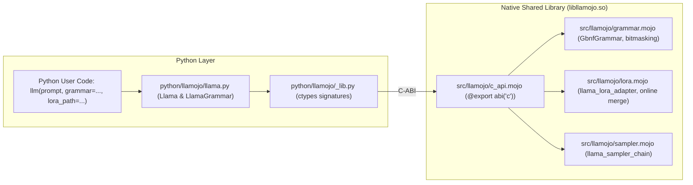
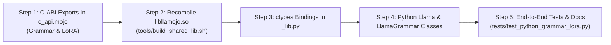

# Architecture & Implementation Plan: GBNF Grammar Sampling and LoRA Adapters via C-ABI in Python

## Executive Summary
This document outlines the design and implementation roadmap for exposing **GBNF Grammar Sampling** and **LoRA Adapters** from pure Mojo to Python through `libllamojo.so` and the high-level `llamojo.Llama` class.

Both capabilities already exist in `llamojo`'s pure-Mojo backend ([`src/llamojo/grammar.mojo`](../src/llamojo/grammar.mojo) and [`src/llamojo/lora.mojo`](../src/llamojo/lora.mojo)), but currently lack C-ABI entry points in `c_api.mojo` and Python bindings in `llamojo`.

---

## 1. System Architecture & Component Mapping



---

## 2. Feature 1: GBNF Grammar Sampling

### A. Objectives & Alignment with `llama-cpp-python`
Upstream `llama-cpp-python` provides:
1. `llama_cpp.LlamaGrammar.from_string(grammar_str: str)`
2. Passing `grammar: Optional[LlamaGrammar]` into `llm.create_completion(..., grammar=grammar)` to guarantee output conforms to a context-free grammar or JSON schema regex.

### B. C-ABI Design in `src/llamojo/c_api.mojo`
Expose the following C-ABI functions:
```mojo
# Opaque handle: llama_grammar_p -> Pointer[GbnfGrammar, MutUntrackedOrigin]

@export
def llama_grammar_init(grammar_cstr: BytePtr) abi("c") -> llama_grammar_p:
    """Parse GBNF grammar string and initialize state machine."""
    ...

@export
def llama_grammar_free(grammar: llama_grammar_p) abi("c"):
    """Free GBNF grammar instance."""
    ...

@export
def llama_sampler_init_grammar(
    grammar: llama_grammar_p,
    vocab: llama_vocab_p,
) abi("c") -> llama_sampler_p:
    """Create a sampler node that evaluates grammar bitmasks during token sampling."""
    ...

@export
def llama_sampler_accept_grammar(
    smpl: llama_sampler_p,
    token: llama_token,
) abi("c"):
    """Advance the grammar parser state after a token is sampled."""
    ...
```

### C. Python Layer Design
In [`python/llamojo/llama.py`](../python/llamojo/llama.py):
1. **`LlamaGrammar` Class**:
   ```python
   class LlamaGrammar:
       def __init__(self, grammar_str: str):
           self._handle = get_lib().llama_grammar_init(grammar_str.encode("utf-8"))
        
       @classmethod
       def from_string(cls, grammar_str: str):
           return cls(grammar_str)
        
       @classmethod
       def from_json_schema(cls, schema: dict):
           # Converts JSON schema to standard GBNF grammar
           ...
       def close(self):
           ...
   ```
2. **Integration into `create_completion` and `_stream_generator`**:
   - When `grammar` is passed, bind it to the sampler chain via `llama_sampler_init_grammar`.
   - On each sampled token, call `llama_sampler_accept_grammar` to advance the pushdown automaton.

---

## 3. Feature 2: LoRA Adapters (Dynamic Ingestion & Merging)

### A. Objectives & Alignment with `llama-cpp-python`
Upstream `llama-cpp-python` allows:
1. Passing `lora_path: Optional[str]` and `lora_scale: float = 1.0` in `Llama.__init__`.
2. Applying LoRA adapters dynamically to loaded base models.

### B. C-ABI Design in `src/llamojo/c_api.mojo`
Expose the following C-ABI functions:
```mojo
# Opaque handle: llama_lora_adapter_p

@export
def llama_lora_adapter_init(
        path_cstr: BytePtr,
    ) abi("c") -> llama_lora_adapter_p:
    """ Load and parse a LoRA adapter GGUF file."""
    ...

@export
def llama_lora_adapter_free(
        adapter: llama_lora_adapter_p,
    ) abi("c"):
    """ Free a loaded LoRA adapter."""
    ...

@export
def llama_lora_adapter_apply(
        model: llama_model_p,
        adapter_path_cstr: BytePtr,
        scale: Float32 = 1.0,
    ) abi("c") -> Int32:
    """ Apply low-rank delta matrices to model weights in-place."""
    ...
```

### C. Python Layer Design
In [`python/llamojo/llama.py`](../python/llamojo/llama.py):
1. **Extend `Llama.__init__`**:
   ```python
   def __init__(
       self,
       model_path: str,
       lora_path: Optional[str] = None,
       lora_scale: float = 1.0,
       ...
   ):
       ...
       if lora_path:
           self.apply_lora(lora_path, scale=lora_scale)
   ```
2. **Add `apply_lora(lora_path: str, scale: float = 1.0)`**:
   - Calls `llama_lora_adapter_apply` on `self._model`.

---

## 4. Implementation Phasing & Work Breakdown



### Step-by-Step Deliverables

| Step | Scope | Files to Modify / Create | Verification Criteria |
|---|---|---|---|
| **Step 1** | Export C symbols for GBNF parser, sampler grammar hook, and LoRA apply | `src/llamojo/c_api.mojo` | Compiles without missing symbols or signature mismatches. |
| **Step 2** | Build shared library with AVX2 hardware flags | Run `tools/build_shared_lib.sh` | `nm -D build/libllamojo.so` exposes `llama_grammar_*` and `llama_lora_*`. |
| **Step 3** | Register `ctypes` argument and return types | `python/llamojo/_lib.py` | Python can import and call low-level grammar & LoRA functions. |
| **Step 4** | Implement `LlamaGrammar` and update `Llama` methods | `python/llamojo/llama.py` | `LlamaGrammar.from_string(...)` and `llm(..., grammar=..., lora_path=...)` supported. |
| **Step 5** | Create unit tests and documentation | `tests/test_python_grammar_lora.py`, `docs/python_grammar_lora_plan.md` | Constrained JSON generation outputs valid JSON; LoRA weights apply cleanly. |

---

## 5. Risk Assessment & Safety Controls

1. **Memory Safety with Opaque Handles**:
   - `llama_grammar_p` and `llama_lora_adapter_p` are allocated via `unsafe_alloc` and deallocated via explicit `_free` calls.
   - Python classes (`LlamaGrammar` and `Llama`) implement `__del__` with null-pointer guards to prevent double frees.
2. **Backward Compatibility**:
   - When `grammar=None` and `lora_path=None` (defaults), the inference and sampling pipeline operates without any overhead or behavioral difference.
3. **Bitmasking Performance**:
   - GBNF regex / pattern matching is evaluated only during the sample step on top candidate tokens, avoiding expensive per-token overhead during prompt prefill.
