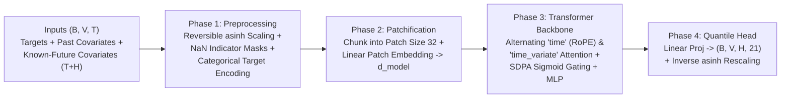

# Implementation Plan: Mistral Timestral in `llamojo`

## 1. Executive Summary

This document outlines the technical design and phased implementation plan for adding **Timestral**—Mistral AI's family of open-source time-series foundation models (`5M`, `28M`, `123M`, `209M`)—to [`llamojo`](..).

Just as `llamojo` successfully integrated OpenAI's Whisper ASR model under [`src/llamojo/whisper/`](../src/llamojo/whisper/) by reusing its zero-copy GGUF loader, persistent spin-barrier worker pool, and SIMD-accelerated quantized kernels, Timestral can be integrated as a self-contained **Quantitative & Time-Series Engine** under `src/llamojo/timestral/`.

### Why `llamojo` is an Ideal Host for Timestral
1. **Shared Transformer Backbone:** Timestral is built on a Mistral-style transformer architecture using RMSNorm, SwiGLU/MLP blocks, and partial Rotary Position Embeddings (RoPE)—all of which already exist in `llamojo`.
2. **Zero-Dependency Edge & Industrial Deployment:** Timestral's primary use cases (see [`timestral_about.md`](./timestral_about.md)) include predictive maintenance, factory telemetry, energy grid load, and real-time anomaly risk bounds. A pure Mojo binary with zero Python/PyTorch/ONNX runtime overhead enables sub-10ms CPU execution for `Timestral-5M`/`28M` and fast local execution for `Timestral-209M`.
3. **Quantized Memory Efficiency:** Using `llamojo`'s `Q8_0` and `Q4_K` kernels reduces `Timestral-209M` from ~837 MB (FP32) to **< 150 MB**, and `Timestral-28M` from ~111 MB to **~18 MB**.

---

## 2. Timestral Architecture Overview

Unlike autoregressive text LLMs that map discrete token IDs to next-token vocabulary logits, Timestral processes continuous and categorical 3D arrays of shape `(Batch, Variates, Time)` and outputs 21 probabilistic quantiles per future step.

### 2.1 Model Variants & Hyperparameters

| Variant | Parameters | FP32 Size | `d_model` | `num_layers` | `patch_size` | `context_length` |
| :--- | :--- | :--- | :--- | :--- | :--- | :--- |
| **Timestral-5M** | 5M | ~21 MB | — | — | 32 | 32,768 |
| **Timestral-28M** | 28M | ~111 MB | 384 | 12 | 32 | 32,768 |
| **Timestral-123M** | 123M | ~490 MB | — | — | 32 | 32,768 |
| **Timestral-209M** | 209M | ~837 MB | 768 | 24 | 32 | 32,768 |

*Reference `config.json` parameters (from `mistralai/Timestral-28M`):*
- `patch_size`: `32` (max $32768 / 32 = 1024$ patches)
- `num_heads`: `6` (for 28M, `head_dim = 64`)
- `mlp_hidden_dim`: `1024` (for 28M)
- `block_schedule`: Alternating sequence of `"time"` and `"time_variate"` layers (e.g., `["time", "time", "time", "time_variate", ...]`)
- `rope_theta`: `10000.0`, `rope_partial_factor`: `0.5`
- `norm_eps`: `1e-6`
- `time_attn_gate` / `variate_attn_gate`: `"sdpa_sigmoid"`
- `use_asinh`: `true`, `minimum_scale`: `1e-6`
- `split_context_horizon_attn`: `true` (Decoupled Horizon Forecasting)
- `quantile_knots`: 21 quantiles `[0.01, 0.05, 0.10, 0.15, ..., 0.90, 0.95, 0.99]`

### 2.2 End-to-End Inference Pipeline



---

## 3. Component Reuse & Gap Analysis in `llamojo`

Approximately **75% of the compute and infrastructure** required by Timestral is already implemented in `llamojo`:

| Timestral Component | Status in `llamojo` | Existing File / New Work Needed |
| :--- | :--- | :--- |
| **GGUF v2/v3 Parser & `mmap64`** | **Ready** | Reuse [`src/llamojo/gguf.mojo`](../src/llamojo/gguf.mojo) |
| **Thread Pool & Spin Barrier** | **Ready** | Reuse [`LlamaWorkerPool`](../src/llamojo/backend/threadpool.mojo) |
| **SIMD Quantized GEMV / GEMM** | **Ready** | Reuse [`kernels_quant.mojo`](../src/llamojo/backend/kernels_quant.mojo) (`F32`, `F16`, `Q8_0`, `Q4_K`, etc.) |
| **RMSNorm & SwiGLU** | **Ready** | Reuse `rms_norm`, `fused_rms_norm_residual`, `fused_silu_mul` in [`kernels_norm_rope.mojo`](../src/llamojo/backend/kernels_norm_rope.mojo) |
| **Partial RoPE (`factor = 0.5`)** | **Extend** | Extend `apply_rope_neox` in [`kernels_norm_rope.mojo`](../src/llamojo/backend/kernels_norm_rope.mojo) to rotate only the first `rope_dim = head_dim * rope_partial_factor` dims |
| **SDPA Sigmoid Gating** | **New** | Implement post-SDPA sigmoid gate (`attn_out * sigmoid(gate_proj(x))`) |
| **Dual-Axis Attention (`time` / `variate`)** | **New** | Implement 2D axial attention dispatch (temporal attention across patches + cross-variate attention across series) |
| **DHF Context/Horizon Split** | **New** | Implement Decoupled Horizon Forecasting mask/split (`split_context_horizon_attn`) |
| **Patchifier & `asinh` Scaling** | **New** | Implement 32-step patching, `NaN` mask concatenation, `asinh` scaling/unscaling, and covariate alignment |
| **Quantile Output Head** | **New** | Linear projection `d_model -> patch_size * 21` + quantile extraction (`median()`, `quantile(q)`) |

---

## 4. Target Directory Layout

Following the modular structure of [`src/llamojo/whisper/`](../src/llamojo/whisper/), Timestral will live in a dedicated subpackage:

```text
src/llamojo/timestral/
├── __init__.mojo       # Public module exports
├── config.mojo         # TimestralConfig, QuantileKnots, BlockSchedule enums
├── patch.mojo          # Patchification, NaN masking, reversible asinh scaling, covariates
├── loader.mojo         # GGUF metadata & tensor pointer binding for Timestral weights
├── model.mojo          # TimestralState, time/variate attention blocks, DHF & quantile head
└── forecast.mojo       # TimestralForecaster high-level API (forecast, impute, quantile access)

tools/
└── convert_timestral_to_gguf.py  # HF SafeTensors/config.json -> GGUF v3 converter

tests/
└── test_timestral.mojo           # Unit tests for patching, scaling, forward pass & parity
```

---

## 5. Phased Implementation Phases

### Phase 1: GGUF Schema & Weight Conversion Tooling [COMPLETED]
*(Full documentation and schema specification in [`docs/phases/timestral_phase1.md`](./phases/timestral_phase1.md))*

**Goal:** Establish a canonical GGUF v3 representation for Timestral checkpoints so `llamojo` can load `5M`, `28M`, `123M`, and `209M` models via zero-copy `mmap64`.

1. **GGUF Metadata Keys:** Canonical `timestral.*` namespace implemented for all hyperparameters, `block_schedule` string array, and 21 `quantile_knots` (`Float32` array).
2. **Canonical Tensor Names:** Mapped Hugging Face SafeTensors (`patch_proj`, `forecast_query`, dual-axis `time_attn`/`variate_attn`, `ffn`, `out_norm`, and `head`).
3. **Weight Converter Tooling:** Implemented [`tools/convert_timestral_to_gguf.py`](../tools/convert_timestral_to_gguf.py) supporting online HF download (`mistralai/Timestral-28M`), local SafeTensors directories, synthetic miniature model generation, and precision options (`f32`, `f16`, `q8_0`).
4. **Pure Mojo Config & Loader:** Implemented [`src/llamojo/timestral/config.mojo`](../src/llamojo/timestral/config.mojo) and [`src/llamojo/timestral/loader.mojo`](../src/llamojo/timestral/loader.mojo).
5. **Unit Verification Suite:** Passing in [`tests/test_timestral_phase1.mojo`](../tests/test_timestral_phase1.mojo).

---

### Phase 2: Configuration & Input Preprocessing (`config.mojo`, `patch.mojo`) [COMPLETED]
*(Full documentation and schema specification in [`docs/phases/timestral_phase2.md`](./phases/timestral_phase2.md))*

**Goal:** Implement the data pipeline in pure Mojo to accept `(Batch, Variates, Time)` float arrays, missing values (`NaN`), and covariates.

1. **`TimeSeriesBatch`:** Multi-variate input container with continuous observations, missing values (`NaN`/`Inf`), and structural roles (`ROLE_TARGET`, `ROLE_PAST_COV`, `ROLE_KNOWN_COV`).
2. **Causal Welford Statistics (`CausalPatchStats`):** Strictly causal running mean and standard deviation along the historical timeline without lookahead leakage.
3. **Reversible `asinh` Instance Scaling:** Stable, non-linear squashing that absorbs extreme spikes and non-stationarity while supporting exact numerical inversion (`apply_affine_asinh`, `invert_affine_asinh`).
4. **Length-32 Patchification & Observation Masks (`PatchBuffer`):** Left-pads historical sequences to multiples of 32 steps, packing 64-dimensional vectors with channel 1 as scaled values and channel 2 as missingness indicators (`0.0` for observed, `1.0` for unobserved/pad).
5. **ResidualBlock Patch Projection:** Implemented `forward_patch_proj` evaluating $W_{\text{out}} \text{SiLU}(W_{\text{hidden}} x + b_{\text{hidden}}) + b_{\text{out}} + W_{\text{res}} x + b_{\text{res}}$ to project 64-dimensional patches into `d_model` tokens.
6. **Decoupled Horizon Query Injection:** Injects the learned `timestral.forecast_query` token across horizon patches for targets while projecting future known covariates.
7. **Unit Verification Suite:** Passing in [`tests/test_timestral_phase2.mojo`](../tests/test_timestral_phase2.mojo).

---

### Phase 3: Backend Kernel Extensions & Dual-Axis Attention (`model.mojo`) [COMPLETED]
*(Full documentation and schema specification in [`docs/phases/timestral_phase3.md`](./phases/timestral_phase3.md))*

**Goal:** Extend `llamojo`'s SIMD kernels where needed and build the Timestral transformer forward pass.

1. **Partial RoPE (`src/llamojo/backend/kernels_norm_rope.mojo`):**
   - Implemented `apply_rope_partial` where `rope_dim = Int(Float32(head_dim) * rope_partial_factor)`. Rotates pairs $(i, i + \frac{head\_dim}{2})$ for $i < \frac{rope\_dim}{2}$, leaving the remaining dimensions unrotated.
2. **SDPA Sigmoid Gating:**
   - Evaluates $\sigma(W_{\text{gate}} x_{\text{normed}})$ and applies element-wise gating to attention outputs before output projection $W_O$.
3. **Time-Axis Attention (`forward_time_attention`):**
   - Multi-head attention across temporal patch sequences with DHF TwoStreamMask rules (causal historical context, full historical context reading for horizon queries) and residual accumulation.
4. **Variate-Axis Attention (`forward_variate_attention`):**
   - Logically permutes $(R, N, D) \to (N, R, D)$, executing unmasked multi-head self-attention across series variates for `"time_variate"` layers.
5. **Fused SwiGLU MLP:**
   - Implemented `forward_swiglu_mlp` evaluating $\text{down}(\text{gate} \cdot \text{SiLU}(\text{up}))$ with residual addition.
6. **Quantile Projection Head & Monotone Cumsum:**
   - Implemented `monotone_quantiles` with free median channel and softplus width cumsum fan-out ensuring strict non-crossing guarantees ($q_1 \le q_2 \le \dots \le q_{21}$), followed by `invert_affine_asinh` denormalization.
7. **Unit Verification Suite:** Passing in [`tests/test_timestral_phase3.mojo`](../tests/test_timestral_phase3.mojo).


---

### Phase 4: GGUF Loader, Workspace State & Public API (`loader.mojo`, `forecast.mojo`)
**Goal:** Provide a clean, zero-allocation runtime API matching the ergonomics of `TimestralForecaster` in [`timestral_about.md`](./timestral_about.md).

1. **Weight Loader (`loader.mojo`):**
   - Maps `GGUFTensorInfo` views to `TimestralLayerWeights` structs.
   - Validates `block_schedule` against tensor counts.
2. **Pre-Allocated State (`TimestralState`):**
   - Allocates reusable activation scratchpads (`q`, `k`, `v`, `attn_scores`, `ffn_buf`, `patch_buf`) sized for `(max_batch, max_variates, max_patches)` to ensure zero heap allocations during inference loops.
3. **High-Level API (`forecast.mojo`):**
   - `TimestralForecaster.from_gguf(path: String) -> TimestralForecaster`
   - `forecaster.forecast(context, prediction_length, past_covariates=..., known_covariates=..., categorical_past_covariates=..., categorical_known_covariates=...) -> ForecastResult`
   - `ForecastResult` methods:
     - `.quantiles` (raw `(B, V, H, 21)` buffer)
     - `.median()` (returns $q = 0.50$ slice `(B, V, H)`)
     - `.quantile(q: Float32)` (interpolates or selects exact knot e.g. `0.90`, `0.95`)
   - Convenience `forecaster.impute(data, strategy=...)` implementing both iterative one-step gap filling and multivariate cross-imputation documented in [`timestral_about.md`](./timestral_about.md#imputation).

---

### Phase 5: Verification, Benchmarking & Python/Interop Bindings
**Goal:** Ensure bit-level / numerical accuracy against the upstream PyTorch reference and expose Timestral to Python/C consumers.

1. **Numerical Parity Suite (`tests/test_timestral.mojo` & Python comparison script):**
   - Export reference input/output tensors from `mistralai/Timestral-28M` in PyTorch.
   - Verify intermediate layer activations (`patch_embed`, layer 0 `time_attn`, first `time_variate` block, final `quantiles`) match within FP32 tolerance ($\text{MAE} < 10^{-4}$).
2. **Use-Case Integration Tests:**
   - Predictive maintenance telemetry test (3 sensors + past ambient humidity + scheduled RPM + binary planned/unplanned outage covariates from [`timestral_about.md`](./timestral_about.md#example-of-predictive-maintainance)).
   - Missing data imputation test (`NaN` gaps in history).
3. **Quantization & Latency Benchmarks:**
   - Benchmark `F32` vs. `Q8_0` vs. `Q4_K` throughput across `T = 96, 512, 4096, 32768` context lengths on multi-core CPU.
4. **C ABI & Python Bridge:**
   - Expose `llamojo_timestral_*` entry points in [`src/llamojo/c_api.mojo`](../src/llamojo/c_api.mojo) and a thin NumPy wrapper in [`python/`](../python/) using [`numojo_bridge.mojo`](../src/llamojo/interop/numojo_bridge.mojo) for zero-copy NumPy $\to$ Mojo array passing.

---

## 6. Technical Risks & Mitigations

| Risk / Challenge | Impact | Mitigation |
| :--- | :--- | :--- |
| **Long Context Attention Memory ($T = 32,768$)** | $N_{\text{patches}} = 1024 \implies 1024 \times 1024$ attention matrix per head/variate | At 1024 patches, FP32 score matrix per head is only 4 MB; process attention head-by-head and variate-by-variate in-place using tiled/online softmax (FlashAttention style) to keep L1/L2 cache residency. |
| **Dynamic Covariate Counts** | Users may pass 0, 1, or $K$ past/known covariates | Process each variate/covariate channel uniformly through the shared patch embedding + role-type embedding (Target vs. Past Covariate vs. Known-Future Covariate) before the `time_variate` attention layers fuse them. |
| **Categorical Target Encoding Parity** | Categorical covariates require specific internal encoding | Inspect `timestral.covariate_encoding.target_encode` in the upstream repo during Phase 1 and replicate the exact causal running-mean encoding in `patch.mojo`. |
| **Numerical Drift in `Q4_K` Quantization** | Continuous regression/quantiles can be more sensitive to weight quantization than discrete token argmax | Keep `patch_embed`, `attn_norm`, `ffn_norm`, and `quantile_head` in `F32`/`F16`, quantizing only the bulk transformer linear weights (`Q8_0` recommended as default, `Q4_K` optional). |
