# Architecture & Implementation Gap Analysis: LLM Training in `llamojo`

## Executive Summary
`llamojo` is currently architected and optimized exclusively as an Ahead-of-Time (AOT) compiled, high-performance CPU **inference engine**. It consumes static model weights in GGUF container formats (`Q4_K_M`, `Q8_0`, FP16, FP32) and executes optimized forward autoregressive decode loops.

To extend `llamojo` to support **end-to-end training of baby models** (such as TinyStories, Karpathy-style mini-Llama 2, or SmolLM-scale 10M–135M parameter models) in pure Mojo, significant architectural infrastructure beyond forward passes must be implemented.

This document systematically details all technical components, mathematical backward formulations, memory layouts, and algorithmic gaps required to enable native model training.

---

## 1. High-Level Training Architecture vs. Inference Runtime

```mermaid
flowchart LR
    subgraph Data Pipeline
        direction TD
        D1[Raw Text Corpus] --> D2[Tokenizer / BPE Pre-tokenization]
        D2 --> D3[Binary Token Shards: memory-mapped uint16/int32]
        D3 --> D4[DataLoader: Batch B, SeqLen T with 1-token shift]
    end

    subgraph Forward Pass with Activation Tape
        direction LR
        D4 --> F1[Token Embeddings + Pos / RoPE]
        F1 --> F2[Transformer Blocks: RMSNorm, GQA, SwiGLU]
        F2 --> F3[Un-embedding Linear Layer / LM Head]
        F3 --> F4[Raw Logits: B, T, Vocab]
        F4 --> F5[Fused Softmax + Cross-Entropy Loss]
    end

    subgraph Backward Propagation
        direction LR
        F5 --> B0[Initial Gradient dLogits = P - 1_target]
        B0 --> B1[LM Head Backward: dW_cls, dX]
        B1 --> B2[Transformer Blocks Backward: dNorm, dAttn, dFFN]
        B2 --> B3[Embedding Backward: Scatter-Add dW_te]
    end

    subgraph Optimizer & Weight Update
        direction LR
        B3 --> O1[Gradient Norm Clipping: L2 Global Norm]
        O1 --> O2[AdamW Step: m_t, v_t, Weight Decay]
        O2 --> O3[Learning Rate Scheduler: Cosine Decay + Warmup]
        O3 --> O4[Updated FP32 Weights]
    end

    subgraph Checkpointing & Export
        direction LR
        O4 --> C1[Training Checkpoint: Weights + Optimizer States]
        O4 --> C2[GGUF Serializer: Export to Q8_0 / Q4_K_M for Inference]
    end
```



---

## 2. Core Technical Gaps Breakdown

### Gap 1: Backward Propagation Kernels (Automatic or Analytic Differentiation)
Inference forward passes reuse and overwrite memory buffers across layers (`RunState.x`, `RunState.xb`, `RunState.hb`). Training requires retaining intermediate activations or implementing recomputation (gradient checkpointing).

Every forward mathematical kernel requires an exact paired backward kernel:

| Operator | Forward Formulation | Backward Derivative Formulations Required |
|---|---|---|
| **Matrix Multiplication (GEMM)** | $Y = X \cdot W^T$ | $dX = dY \cdot W$ (input grad)<br>$dW = dY^T \cdot X$ (weight grad) |
| **RMSNorm** | $y = \frac{x}{\sqrt{\frac{1}{d}\sum x_i^2 + \epsilon}} \odot \gamma$ | $d\gamma = \sum (dy \odot \hat{x})$<br>$dx = \frac{\gamma}{\text{RMS}}\left(dy - \hat{x} \frac{1}{d} \sum (dy \odot \hat{x})\right)$ |
| **RoPE (Rotary Position Embeddings)** | $\begin{pmatrix} x_1' \\ x_2' \end{pmatrix} = R_\theta \begin{pmatrix} x_1 \\ x_2 \end{pmatrix}$ | Orthogonal rotation matrix: backward is rotation with negated angle $-\theta$ ($R_{-\theta} = R_\theta^T$). |
| **SwiGLU Non-Linearity** | $H = \text{SiLU}(X W_1) \odot (X W_3)$<br>$\text{SiLU}(z) = z \cdot \sigma(z)$ | Product rule with SiLU derivative:<br>$\frac{d}{dz}\text{SiLU}(z) = \sigma(z) \cdot (1 + z(1 - \sigma(z)))$.<br>Yields $dW_1, dW_3$, and input gradient $dX$. |
| **Causal Self-Attention** | $S = \frac{Q K^T}{\sqrt{d_k}} + M$<br>$P = \text{softmax}(S)$<br>$O = P \cdot V$ | $dV = P^T \cdot dO$<br>$dP = dO \cdot V^T$<br>$dS = P \odot (dP - \sum (dP \odot P))$<br>$dQ = \frac{1}{\sqrt{d_k}} dS \cdot K$<br>$dK = \frac{1}{\sqrt{d_k}} dS^T \cdot Q$ |
| **Token Embedding** | $X_{b,t} = E[tokens_{b,t}]$ | Scatter-add into weight gradient tensor:<br>$dE[k] += \sum_{\{b,t \mid tokens_{b,t}=k\}} dX_{b,t}$ |

---

### Gap 2: Loss Criterion & Analytic Logit Gradients
Inference only samples from raw logits. Training requires evaluating prediction error against target token labels and launching backward propagation:

1. **Cross-Entropy Loss**:
   $$\mathcal{L} = -\frac{1}{N} \sum_{i=1}^N \ln P(y_i \mid x_i), \quad \text{where } N = B \times T$$
2. **Fused Softmax-Cross-Entropy Backward Kernel**:
   Directly applying the chain rule through softmax and cross-entropy yields an elegant, numerically stable analytic gradient:
   $$\frac{\partial \mathcal{L}}{\partial z_{b,t,v}} = \frac{P_{b,t,v} - \mathbf{1}_{\{v = y_{b,t}\}}}{B \cdot T}$$
   Implementing this fused kernel avoids materializing the massive Jacobian matrix of size $(V \times V)$ in memory.

---

### Gap 3: Memory Layout & Activation Stashing
Training requires approximately **$4\times$ to $6\times$ more memory** than inference due to gradient and optimizer state tracking:

```
Memory Footprint Comparison (e.g. 100M FP32 Model):
==================================================
Inference:
  - Model Weights:              ~400 MB
  - Activation Scratch Buffer:   ~10 MB
  - KV Cache:                    ~50 MB
  Total:                        ~460 MB

Training (Batch=8, SeqLen=512):
  - Model Weights (FP32):       ~400 MB
  - Weight Gradients (dW):      ~400 MB
  - AdamW First Momentum (m):   ~400 MB
  - AdamW Second Momentum (v):  ~400 MB
  - Activation Tape (Tensors):  ~850 MB
  Total:                       ~2.45 GB
```

To support this in Mojo:
- **`GradTensor` Struct**: Mirroring each parameter tensor with a contiguous gradient allocation (`data` and `grad` pointers).
- **Activation Tape**: Memory arena holding intermediate layer inputs for backward passes, freed sequentially in reverse order after every optimizer step.

---

### Gap 4: First-Class Optimizer Engine (AdamW)
Once gradients $\nabla_W \mathcal{L}$ are accumulated, the optimizer updates model weights:

1. **AdamW State Update Equations**:
   $$m_t = \beta_1 m_{t-1} + (1 - \beta_1) g_t$$
   $$v_t = \beta_2 v_{t-1} + (1 - \beta_2) g_t^2$$
   $$\hat{m}_t = \frac{m_t}{1 - \beta_1^t}, \quad \hat{v}_t = \frac{v_t}{1 - \beta_2^t}$$
   $$W_t = W_{t-1} - \eta_t \left( \frac{\hat{m}_t}{\sqrt{\hat{v}_t} + \epsilon} + \lambda W_{t-1} \right)$$
   Where $\eta_t$ is the learning rate and $\lambda$ is the decoupled weight decay factor.
2. **Global Gradient Norm Clipping**:
   Calculates global L2 norm across all weight gradients:
   $$\|g\|_2 = \sqrt{\sum_i \|g_i\|_2^2}$$
   If $\|g\|_2 > \text{max\_norm}$, scale all gradients by $\frac{\text{max\_norm}}{\|g\|_2}$ to prevent exploding gradients.
3. **Learning Rate Scheduler**:
   Linear warmup followed by cosine annealing down to a minimum learning rate ($\eta_{\text{min}} = 0.1 \times \eta_{\text{max}}$).

---

### Gap 5: High-Throughput Data Pipeline & DataLoader
An inference engine takes a single prompt string or token list. Training requires high-throughput batch streaming:
- **Token Sharding**: Pre-tokenizing text corpora (e.g. TinyStories dataset) into binary files of raw `uint16` / `int32` token arrays.
- **Batching & Striding**:
  - Memory-mapping contiguous token files (`mmap`).
  - Slicing batch inputs $X \in \mathbb{R}^{B \times T}$ and target shifted labels $Y \in \mathbb{R}^{B \times T}$ where $Y_{b,t} = X_{b, t+1}$.
  - Multi-threaded prefetching and deterministic pseudo-random shuffling across epochs.

---

### Gap 6: Model Checkpointing & GGUF Export
- **Resumable Checkpoints**: Serializing $(W, dW, m, v, \text{step}, \text{loss})$ so long training runs can pause and recover.
- **GGUF Writer**: Once baby models are trained in FP32, an export bridge is required to package them into valid GGUF container files (and quantize to `Q8_0` or `Q4_K_M`) so they can immediately be loaded into `llamojo.Llama` for inference.

---

## 3. Recommended Implementation Roadmap for Baby Model Training

If implementing a native training engine for baby models in `llamojo`, the work should be structured in 4 phases:

### Phase 1: Core Backward Math & Layer Kernels
- Implement `matmul_backward` (vectorized AVX2 / SIMD).
- Implement `rmsnorm_backward`, `rope_backward`, and `swiglu_backward`.
- Implement `attention_backward` (causal score backpropagation).
- Verify every gradient with numeric finite-difference testing ($\frac{f(x+\epsilon) - f(x-\epsilon)}{2\epsilon}$).

### Phase 2: Loss Criterion & Optimizer
- Implement fused `softmax_cross_entropy_backward`.
- Build `AdamW` struct with vectorized momentum updates, weight decay, and gradient clipping.
- Implement cosine learning rate scheduler with linear warmup.

### Phase 3: DataLoader & Training Loop
- Build a binary memory-mapped `DataLoader` supporting $(B, T)$ batching.
- Implement the forward-backward execution loop with activation tape management.
- Validate convergence on a small synthetic dataset (e.g., memorizing 100 sequences to zero loss).

### Phase 4: Training TinyStories & GGUF Export
- Train a 15M baby Llama on TinyStories.
- Implement GGUF writer to serialize trained weights into `.gguf`.
- Load the generated `.gguf` directly into `llamojo.Llama` to verify coherent text generation.

