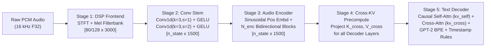

# Feasibility & Architectural Study: Running Whisper ASR Models in `llamojo`

## 1. Executive Summary

This study evaluates the technical feasibility and architectural trade-offs of incorporating **OpenAI Whisper Automatic Speech Recognition (ASR)** models into the **`llamojo`** ecosystem, based on a direct examination of [`/whisper.cpp`](../../../Programming/whisper.cpp) and the existing [`llamojo`](..) codebase.

We compare two primary architectural paths:
- **Alternative A (Integrated Multi-Modal Extension in `llamojo`)**: Extending `llamojo` with an audio frontend (`whisper.mojo`), 1D convolutions, LayerNorm with bias, and Encoder-Decoder Cross-Attention.
- **Alternative B (Standalone `whisper.mojo` Repository)**: Creating an independent repository modelled purely after `whisper.cpp`.

**Recommendation**: **Alternative A (Extending `llamojo`)** is overwhelmingly superior. Approximately **75%–80% of the required infrastructure**—including SIMD quantized dot-product kernels (`Q4_0` through `Q6_K`), persistent spin-barrier worker thread pools, GPT-2 byte-level BPE tokenization, `LlamaKVCache` cell management, GBNF grammar constraints, and Python `ctypes` packaging—is already implemented and battle-tested in `llamojo`. Furthermore, keeping Whisper inside `llamojo` unlocks native **Speech-to-LLM pipelines** and unified multimodal serving in a single shared library (`libllamojo.so`).

---

## 2. Deep-Dive Analysis of `whisper.cpp` Architecture

From inspecting [`whisper.h`](../../../Programming/whisper.cpp/include/whisper.h), [`whisper-arch.h`](../../../Programming/whisper.cpp/src/whisper-arch.h), and [`whisper.cpp`](../../../Programming/whisper.cpp/src/whisper.cpp), the `whisper.cpp` execution pipeline consists of five distinct stages:



### 2.1 Audio Preprocessing & Log-Mel Spectrogram (`whisper_pcm_to_mel`)
- **Input**: 16,000 Hz mono PCM 32-bit float audio array, processed in 30-second windows ($480,000$ samples).
- **STFT Parameters**:
  - `WHISPER_N_FFT = 400` (25 ms window), `WHISPER_HOP_LENGTH = 160` (10 ms step).
  - Precomputed periodic **Hann window** of length 400 and precomputed $\sin/\cos$ tables (`whisper_global_cache` at [`whisper.cpp:3068`](../../../Programming/whisper.cpp/src/whisper.cpp#L3068-L3172)).
  - In-place recursive Cooley-Tukey FFT (`fft()` at [`whisper.cpp:3129`](../../../Programming/whisper.cpp/src/whisper.cpp#L3129-L3171)) producing $1 + 400/2 = 201$ frequency bins per frame across $3,000$ frames.
- **Mel Filterbank Projection**:
  - Multiplies power spectrum $[201 \times 3000]$ by Mel filters $[n_{\text{mels}} \times 201]$ stored inside the model file ($n_{\text{mels}} = 80$ for Tiny/Base/Small/Medium/Large-v1/v2, and $n_{\text{mels}} = 128$ for Large-v3 and Large-v3-Turbo).
  - Applies clamped logarithmic scaling: $\log_{10}(\max(\text{mel}, 10^{-10}))$, clamped to $\max - 8.0$, and normalized via $(\text{val} + 4.0) / 4.0$.

### 2.2 Convolutional Stem (`whisper_build_graph_conv`)
Defined at [`whisper.cpp:2024`](../../../Programming/whisper.cpp/src/whisper.cpp#L2024-L2084):
1. **`conv1`**: 1D Convolution (`ggml_conv_1d_ph`) with kernel size $K=3$, stride $S=1$, padding $P=1$, mapping $[n_{\text{mels}}, 3000] \to [n_{\text{audio\_state}}, 3000]$, followed by bias addition and **GELU** activation.
2. **`conv2`**: 1D Convolution with kernel size $K=3$, stride $S=2$, padding $P=1$, downsampling time by $2\times$: $[n_{\text{audio\_state}}, 3000] \to [n_{\text{audio\_state}}, 1500]$, followed by bias addition and **GELU**.
3. **Learned / Sinusoidal Positional Embedding**: Adds `encoder.positional_embedding` ($[n_{\text{audio\_state}}, 1500]$) to the transposed convolutional output.

### 2.3 Bidirectional Audio Encoder (`whisper_build_graph_encoder`)
Defined at [`whisper.cpp:2086`](../../../Programming/whisper.cpp/src/whisper.cpp#L2086-L2317):
- Runs $N_{\text{audio\_layer}}$ transformer blocks over fixed sequence length $n_{\text{audio\_ctx}} = 1500$ (or dynamic slice via `exp_n_audio_ctx`).
- **Pre-LayerNorm**: Standard LayerNorm (mean AND variance normalization with scale `w` and bias `b`, unlike LLaMA's RMSNorm).
- **Bidirectional Multi-Head Self-Attention**:
  - `Q` has bias (`attn.query.bias`), `K` has **no bias** (`attn.key.weight` only), `V` has bias (`attn.value.bias`), output projection has bias (`attn.out.bias`).
  - Full unmasked $1500 \times 1500$ attention across all audio frames.
- **MLP Block**: Pre-LayerNorm $\to$ Linear ($d \to 4d$ with bias) $\to$ **GELU** $\to$ Linear ($4d \to d$ with bias) + Residual.
- **Post-LayerNorm**: `encoder.ln_post.weight` and `encoder.ln_post.bias`.

### 2.4 Static Cross-Attention KV Pre-Computation (`whisper_build_graph_cross`)
Defined at [`whisper.cpp:2320`](../../../Programming/whisper.cpp/src/whisper.cpp#L2320-L2396):
- A crucial architectural optimization: because the encoded audio representation `embd_enc` ($[n_{\text{audio\_state}}, 1500]$) is **invariant** across all autoregressive text decoding steps for a 30s audio chunk, `whisper.cpp` computes `Kcross` and `Vcross` for every decoder layer **once per audio segment** and stores them in a dedicated `kv_cross` buffer (`whisper_state.kv_cross`).

### 2.5 Autoregressive Text Decoder (`whisper_build_graph_decoder`)
Defined at [`whisper.cpp:2527`](../../../Programming/whisper.cpp/src/whisper.cpp#L2527-L2905):
- Context window: $n_{\text{text\_ctx}} = 448$ tokens.
- **Embeddings**: Learned token embedding (`decoder.token_embedding.weight`) + learned positional embedding (`decoder.positional_embedding`, indexed by token position `pos`, **not** RoPE).
- Each of the $N_{\text{text\_layer}}$ blocks executes **three** sub-layers:
  1. **Causal Self-Attention**: Pre-LayerNorm $\to$ QKV projections $\to$ updates `kv_self` cache $\to$ Causal masked attention $\to$ Output projection + Residual.
  2. **Encoder-Decoder Cross-Attention**: Pre-LayerNorm (`cross_attn_ln`) $\to$ computes `Q` from current decoder hidden state ($[n_{\text{state}}, n_{\text{tokens}}]$) $\to$ attends over static `kv_cross.k` and `kv_cross.v` ($[n_{\text{state}}, 1500]$) $\to$ Output projection + Residual.
  3. **Feed-Forward Network**: Pre-LayerNorm $\to$ Linear ($d \to 4d$) $\to$ **GELU** $\to$ Linear ($4d \to d$) + Residual.
- **Final Logits**: Post-LayerNorm (`decoder.ln`) followed by tied matrix multiplication with `decoder.token_embedding.weight`.

### 2.6 Vocabulary, Special Tokens & Timestamp Logit Rules
- Whisper uses the exact **GPT-2 Byte-Level BPE** vocabulary ($50,257$ base tokens) augmented with task, language, and timestamp tokens:
  - `token_eot = 50256` (`<|endoftext|>`)
  - `token_sot = 50257` (`<|startoftranscript|>`)
  - Language tokens: $99$ languages (`<|en|>`, `<|es|>`, `<|de|>`, etc.)
  - Task tokens: `<|translate|>`, `<|transcribe|>`, `<|notimestamps|>`
  - **Timestamp tokens**: $1,501$ tokens starting at `token_beg = 50363` (`<|0.00|>` to `<|30.00|>` in 20 ms increments).
- During decoding, `whisper.cpp` applies specialized logit filters (`ApplyTimestampRules`):timestamps must appear in pairs, must be monotonically increasing, and guide segment seeking (`seek_delta`).

---

## 3. Component Mapping: What `llamojo` Already Has vs. What Is Needed

| Subsystem | `whisper.cpp` Requirement | Existing `llamojo` Capability | Reuse % | Required Engineering Delta |
|---|---|---|---|---|
| **Quantized Linear Kernels** | `Q4_0`, `Q4_1`, `Q5_0`, `Q5_1`, `Q8_0`, `Q4_K`, `Q5_K`, `Q6_K`, `F16`, `F32` | [`kernels_quant.mojo`](../src/llamojo/backend/kernels_quant.mojo) has AVX2/AVX-512 SIMD kernels for all GGML types + Q8 activation quantization | **100%** | Add optional bias vector addition `y[i] += bias[i]` after `dot_quant_row`. |
| **Multithreading & Barriers** | Multi-core dispatch for encoder GEMM and decoder GEMV | [`threadpool.mojo`](../src/llamojo/backend/threadpool.mojo) (`LlamaWorkerPool` persistent spin-barrier) | **95%** | Reuse directly for both Encoder batch GEMM ($T=1500$) and Decoder GEMV ($T=1$). |
| **Model Loader** | Legacy GGML `.bin` (`0x67676d6c`) and modern Whisper GGUF | [`gguf.mojo`](../src/llamojo/gguf.mojo) zero-copy mmap GGUF v2/v3 reader | **85%** | GGUF Whisper models work out-of-the-box; optionally add a ~120-line reader for legacy `ggml-base.en.bin` headers & mel filters. |
| **Tokenizer** | GPT-2 Byte-Level BPE + Whisper special/timestamp tokens | [`vocab_gpt2.mojo`](../src/llamojo/vocab_gpt2.mojo) implements full GPT-2 byte table & rank BPE | **95%** | Register Whisper's dynamic special token IDs (`sot`, `eot`, `lang`, `[_TT_*]`). |
| **KV Cache** | `kv_self` (448 tokens) + `kv_cross` (1500 audio frames) | [`kv_cache.mojo`](../src/llamojo/kv_cache.mojo) (`LlamaKVCache` with `seq_rm`, `seq_cp`, `cells`) | **90%** | Instantiate two `LlamaKVCache` instances in `whisper_context`: `kv_self` ($L_{\text{ctx}}=448$) and `kv_cross` ($L_{\text{ctx}}=1500$). |
| **Activations & Norms** | `GELU` and `LayerNorm` (mean + variance + bias) | [`kernels_norm_rope.mojo`](../src/llamojo/backend/kernels_norm_rope.mojo) has `gelu()`, `rms_norm()` | **70%** | Add `layer_norm(out, x, weight, bias, n, eps)` (subtracts mean before variance scaling). |
| **Grammar & Sampling** | Greedy, Temperature fallback, Beam Search, GBNF Grammar | [`sampler.mojo`](../src/llamojo/sampler.mojo) & [`grammar.mojo`](../src/llamojo/grammar.mojo) | **85%** | Add Whisper timestamp logit masking processor and optional Beam Search ($N \le 8$ decoders using `kv_cache_seq_cp`). |
| **Audio Frontend & Conv1D** | 16 kHz PCM $\to$ STFT $\to$ 80/128 Mel $\to$ 2x `Conv1D` | *Not present in `llamojo`* | **0%** | **New module (`audio.mojo`)**: ~250 lines for Hann window, Cooley-Tukey FFT, log-Mel filterbank, and `conv1d_f32` ($K=3, S=1,2$). |

---

## 4. Architectural Comparison: Extension in `llamojo` vs. Standalone Project

We evaluate the two strategic alternatives across six engineering dimensions:

| Dimension | Alternative A: Extend `llamojo` (Unified Engine) | Alternative B: Standalone `whisper.mojo` Project |
|---|---|---|
| **Code Reuse & Maintenance** | **High Reuse (~80%)**: Shares all AVX2/AVX-512 quantized dot products, thread pool barriers, GGUF parser, GPT-2 BPE tokenizer, KV cache, and GBNF grammar engine. Bug fixes or kernel speedups (e.g., Phase 7 `pmaddubsw`) immediately accelerate both LLMs and Whisper. | **High Duplication**: Requires copying or cross-linking ~15,000 lines of quantization kernels, GGUF parsing, thread pools, and BPE tokenizers. |
| **Binary & Python Packaging** | **Single Shared Library (`libllamojo.so`)**: Exposes both `llama_*` and `whisper_*` C-ABI symbols (or a unified `llamojo.Whisper` Python class alongside `llamojo.Llama`). Zero duplicate runtime footprint. | **Separate Binary (`libwhispermojo.so`)**: Forces users to compile, distribute, and load two separate shared libraries and manage conflicting thread pools in the same process. |
| **Multi-Modal & Voice-Agent Pipelines** | **Zero-Copy Speech-to-LLM**: Audio transcribed by Whisper can pass token IDs or encoder embeddings directly in-memory to a Gemma 4 / LLaMA-3 / Laya model running in the same `LlamaWorkerPool` with zero IPC or serialization overhead. | **Process/Python Boundary Overhead**: Requires marshaling audio transcripts or states through Python between two independent engines. |
| **Encoder-Decoder Generality** | **Unlocks Broader Model Families**: Adding `layer_norm`, `conv1d`, and `cross_attention` to `llamojo/backend/` immediately enables not just Whisper, but also **T5, Bart, Florence-2, Moonshine, and Audio-LLMs (Qwen2-Audio / Ultravox)** which use the exact same Whisper audio tower! | **Siloed to ASR**: Architectural blocks remain isolated in an ASR-only repository and cannot be composed into multimodal LLMs. |
| **API Ergonomics** | Unified Hugging Face facade (`hf_compat.py` can support `AutoModelForSpeechSeq2Seq` & `pipeline("automatic-speech-recognition")` right next to `AutoModelForCausalLM`). | Requires maintaining a separate Python package, separate CI test runners, and separate documentation bundles. |
| **Complexity / Scope Risk** | Slight increase in repository scope, easily mitigated by modularizing audio/ASR files under `src/llamojo/whisper/` or `src/llamojo/audio.mojo`. | Clean initial slate, but rapid divergence from `llamojo` and `ggojo` kernel improvements. |

### Key Insight: The Whisper Encoder is the Universal Audio Tower for Multimodal LLMs
Modern open-weights multimodal models (such as **Ultravox**, **Qwen2-Audio**, and **LLaMA-Omni**) literally use the **Whisper Encoder (`conv1` + `conv2` + bidirectional blocks)** as their audio frontend, feeding `embd_enc` through a linear projector directly into a LLaMA or Gemma decoder!
By implementing Whisper inside `llamojo`, `llamojo` simultaneously gains:
1. Standalone **Whisper ASR** (`tiny`, `base`, `small`, `medium`, `large-v3`, `large-v3-turbo`).
2. The exact audio encoder required for **Direct Speech-to-LLM multimodal inference**.

---

## 5. Proposed Architecture for Whisper in `llamojo`

To keep `llamojo` clean and modular without bloating `llama.mojo`, Whisper support should be structured as a cohesive sub-package sharing `llamojo`'s core and backend layers:

```text
src/llamojo/
├── backend/
│   ├── kernels_norm_rope.mojo    # + Add layer_norm() with weight & bias
│   ├── kernels_conv.mojo         # [NEW] conv1d_f32 (K=3, S=1/2, P=1) & sinusoidal/learned pos embd
│   └── kernels_attn.mojo         # + Add encoder_self_attn() & decoder_cross_attn()
├── whisper/                      # [NEW] Dedicated Whisper ASR sub-package
│   ├── __init__.mojo
│   ├── audio.mojo                # 16kHz PCM -> Hann Window -> Cooley-Tukey FFT -> Log-Mel [80/128 x 3000]
│   ├── loader.mojo               # Supports both GGUF Whisper and legacy ggml-Model.bin (0x67676d6c)
│   ├── model.mojo                # WhisperConfig, WhisperEncoderLayer, WhisperDecoderLayer, WhisperModel
│   └── transcribe.mojo           # whisper_encode, whisper_decode, timestamp rules, 30s seek loop
└── c_api.mojo                    # + Export whisper_init_from_file, whisper_full, whisper_full_get_segment_*
```

### 5.1 Detailed Implementation Phases

#### Phase 1: Core Kernels (`layer_norm`, Biased Projections, and `conv1d`)
1. **`layer_norm` with Bias**:
   $$\text{LayerNorm}(x)_i = \frac{x_i - \mu}{\sqrt{\sigma^2 + \epsilon}} \cdot \gamma_i + \beta_i$$
   Vectorized with `SIMD_WIDTH` in [`kernels_norm_rope.mojo`](../src/llamojo/backend/kernels_norm_rope.mojo).
2. **Biased Quantized MatMul**:
   Extend `matmul_quant_fused` in [`kernels_quant.mojo`](../src/llamojo/backend/kernels_quant.mojo) with an optional `bias: FloatPtr` parameter so `Q`, `V`, `out`, and `MLP` projections add bias in-register before storing.
3. **1D Convolution (`conv1d_f32`)**:
   Since Whisper only uses two fixed 1D convolutions ($K=3, P=1, S \in \{1, 2\}$) on $3,000$ frames, implement a direct cache-friendly 3-tap SIMD convolution combined with fused GELU activation.

#### Phase 2: DSP Audio Frontend (`audio.mojo`)
1. Port `whisper.cpp`'s zero-dependency Cooley-Tukey FFT (`WHISPER_N_FFT = 400`, `WHISPER_HOP_LENGTH = 160`) and periodic Hann window table into pure Mojo.
2. Parallelize the 3,000-frame STFT + Mel filterbank matrix multiplication across `LlamaWorkerPool` threads.
3. Add a lightweight `.wav` RIFF header parser (16-bit PCM mono/stereo to 16 kHz F32) for zero-dependency CLI and test execution.

#### Phase 3: Dual Model Loader (GGUF + Legacy `.bin`)
1. **GGUF Support**: Map Whisper GGUF tensors (`encoder.conv1.weight`, `encoder.blocks.%d.*`, `decoder.blocks.%d.*`) using [`gguf.mojo`](../src/llamojo/gguf.mojo).
2. **Legacy `ggml` `.bin` Support**: Because many users (including `/mnt/c/Documents/Programming/whisper.cpp/ggml-base.en.bin`) have standard `whisper.cpp` `.bin` files (`magic == 0x67676d6c`), provide a ~120-line sequential binary header reader in `whisper/loader.mojo` that reads the 11 `int32` `hparams`, embedded `whisper_filters`, vocabulary table, and maps raw tensor pointers into the exact same `WhisperModel` struct.

#### Phase 4: Encoder, Cross-KV Cache, and Decoder Execution (`whisper/model.mojo`)
1. **Audio Encoder Forward**: Execute `conv1` $\to$ `conv2` $\to$ add `e_pe` $\to$ $N_{\text{audio\_layer}}$ bidirectional self-attention blocks.
2. **Cross-Attention KV Precomputation**: Compute `Kcross` (scaled by $d_{\text{head}}^{-0.25}$) and `Vcross` for all $N_{\text{text\_layer}}$ layers once per 30-second window and store in `kv_cross: LlamaKVCache`.
3. **Autoregressive Decoder Step**:
   - Lookup `d_te[token] + d_pe[pos]`.
   - Run Causal Self-Attention against `kv_self: LlamaKVCache`.
   - Run Cross-Attention where `Q` ($1 \times d$) attends over static `kv_cross` ($1500 \times d$) using `gqa_decode` ($n_{\text{kv\_heads}} = n_{\text{heads}}$).
   - Run GELU FFN + Residual.

#### Phase 5: Timestamp Logit Rules, C-ABI & Python `Whisper` Wrapper
1. Implement Whisper's special token suppression (`suppress_blank`, `suppress_nst`) and paired timestamp constraints (`ApplyTimestampRules`).
2. Expose C-ABI functions (`whisper_init_from_file`, `whisper_full`, `whisper_full_n_segments`, `whisper_full_get_segment_text`, `whisper_full_get_segment_t0`, `whisper_full_get_segment_t1`) in `libllamojo.so`.
3. Add `llamojo.Whisper` and `hf_compat` `AutoModelForSpeechSeq2Seq` in Python.
